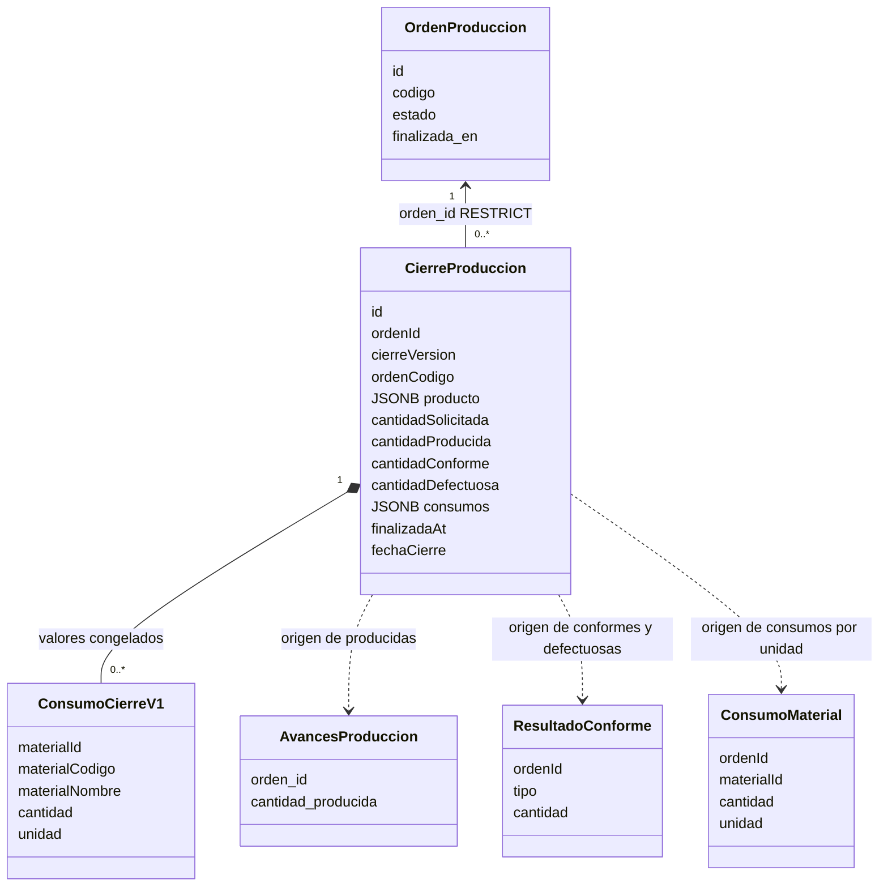

# ABC-299: clases del snapshot de cierre

El repositorio guarda diagramas en `docs/diagramas/`; se añade este diagrama de
clases para el nuevo modelo. [Detalles y pruebas](../../services/produccion-service/src/cierre-produccion/README.md).

Las dependencias punteadas indican el origen de los datos al construir el
snapshot, no nuevas relaciones de base de datos. `ConsumoCierreV1` es el tipo
ya existente de los valores JSONB; no es otra tabla ni duplica los registros de
ABC-71. Cada orden y versión identifica un único snapshot. Los campos históricos
se leen del cierre y no se vuelven a consultar a través de estas dependencias.
