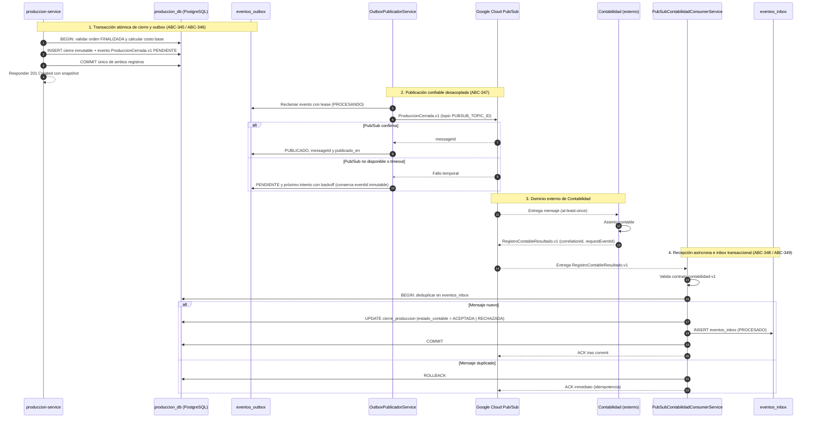

# Flujo Contabilidad v1 (ABC-114 / ABC-406)

Flujo de integración asíncrona entre `produccion-service` y Contabilidad implementado en el Sprint 3 mediante el patrón **Transactional Outbox / Inbox** y mensajería en Google Cloud Pub/Sub.

El diagrama detallado del Sprint 3 con todas las fases de negocio, persistencia, cálculo de costo base (ABC-345) y consumo de respuesta (ABC-348) se encuentra en:
- [09-contabilidad-cierre-costos.mmd](sprint-3/secuencia/09-contabilidad-cierre-costos.mmd)
- [SVG](sprint-3/secuencia/09-contabilidad-cierre-costos.svg) | [PNG](sprint-3/secuencia/09-contabilidad-cierre-costos.png) | [PDF](sprint-3/secuencia/09-contabilidad-cierre-costos.pdf)

