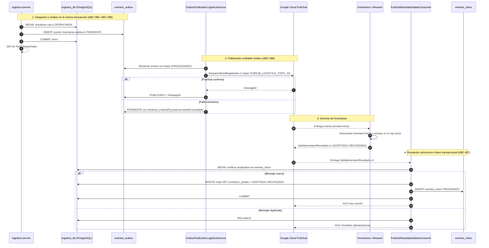

# Flujos de Integración con Inventarios / Almacén v1 (ABC-113 / ABC-384 / ABC-406)

Este documento centraliza los flujos de mensajería asíncrona hacia el servicio externo de Inventarios y Almacén mediante Google Cloud Pub/Sub con garantía transaccional Outbox/Inbox.

---

## 1. Salida de Productos y Despacho Logístico (Sprint 3: ABC-384 / ABC-406)

Notificación del despacho de rutas de entrega a Inventarios para la baja física de stock, confirmada mediante Transactional Outbox y respuesta asíncrona procesada en Inbox (`SalidaInventarioResultado.v1`).

Diagrama oficial del incremento:
- [10-inventarios-despacho-salida.mmd](sprint-3/secuencia/10-inventarios-despacho-salida.mmd)
- [SVG](sprint-3/secuencia/10-inventarios-despacho-salida.svg) | [PNG](sprint-3/secuencia/10-inventarios-despacho-salida.png) | [PDF](sprint-3/secuencia/10-inventarios-despacho-salida.pdf)

---

## 2. Solicitud y Disponibilidad de Materiales en Producción (ABC-113 / ABC-70)

- Verificación previa de disponibilidad de materiales antes de iniciar orden: [06-produccion-inicio-orden.svg](sprint-3/secuencia/06-produccion-inicio-orden.svg).
