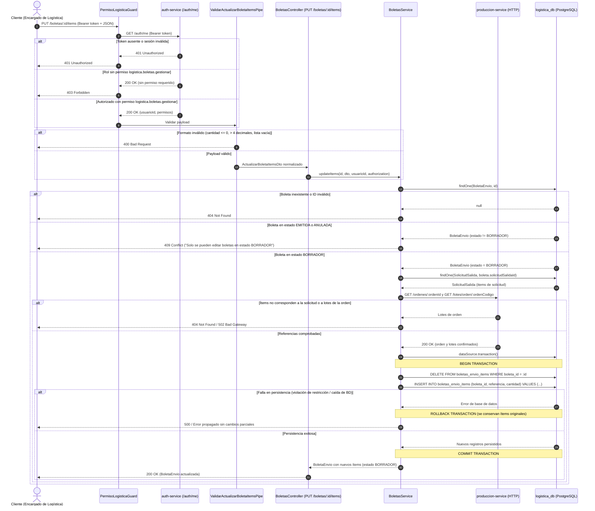

# ABC-286: secuencia de edición de ítems de boleta en borrador v1

Este documento detalla el diseño, las reglas operativas y el diagrama de secuencia para la edición de ítems de una boleta de envío en estado `BORRADOR`, dando cumplimiento a las tareas **ABC-220** y **ABC-286** bajo la historia de usuario **ABC-78**.

---

## 1. Objetivo y alcance

- **Objetivo:** Permitir al Encargado de Logística corregir cantidades o sustituir referencias de lotes asignados a una boleta antes de su emisión definitiva, sin alterar el número único de la boleta, su estado documental ni el saldo disponible.
- **Alcance incluido:**
  - Actualización atómica de la colección de ítems (`DELETE` previo e `INSERT` de nuevos ítems en la misma transacción).
  - Validación de estado estricto: solo se admiten modificaciones en boletas en estado `BORRADOR`.
  - Validación de referencias: comprobación cruzada contra la solicitud de salida y los lotes válidos de Producción vía API interna.
  - Validación de cantidades: números estrictamente positivos con hasta cuatro decimales (`NUMERIC(14,4)`).
- **Alcance no incluido:**
  - Edición de boletas en estado `EMITIDA` o `ANULADA`.
  - Modificación del número correlativo o del responsable original de creación.
  - Reserva física o descuento de saldos documentales (el saldo solo descuenta boletas `EMITIDA`).

---

## 2. Reglas de negocio y respuestas HTTP

| Regla | Condición técnica | Código HTTP |
| :--- | :--- | :--- |
| **Autenticación requerida** | Token Bearer ausente, inválido o expirado | `401 Unauthorized` |
| **Autorización mínima** | Usuario no posee el permiso `logistica.boletas.gestionar` | `403 Forbidden` |
| **Estructura del payload** | Formato de body inválido, ítems vacío, cantidad `<= 0`, o más de 4 decimales | `400 Bad Request` |
| **Existencia de boleta** | El identificador no existe en `boletas_envio` o es inválido | `404 Not Found` |
| **Inmutabilidad por estado** | La boleta se encuentra en estado `EMITIDA` o `ANULADA` | `409 Conflict` |
| **Referencias ajenas** | Uno o más ítems no pertenecen a la solicitud o a los lotes de Producción | `404 Not Found` |
| **Falla de fuente externa** | Producción no responde o envía datos incompletos | `502 Bad Gateway` / `503 Service Unavailable` |
| **Rollback transaccional** | Error durante la escritura en base de datos (`DELETE` o `INSERT`) | `500 Internal Server Error` (Rollback) |
| **Operación exitosa** | Ítems actualizados de forma atómica conservando número y estado `BORRADOR` | `200 OK` |

---

## 3. Diagrama de secuencia

---

## 4. Garantía de atomicidad e integridad

1. **Reemplazo atómico:** Al ejecutarse dentro de un bloque `dataSource.transaction`, el borrado de las filas anteriores y la inserción de las nuevas filas se confirman o se descartan en una sola unidad lógica de trabajo.
2. **Sin filas parciales ni huérfanas:** Si cualquiera de los nuevos ítems falla en validación de base de datos (`ck_boleta_envio_item_cantidad`, `ck_boleta_envio_item_referencia`), el motor PostgreSQL revierte automáticamente el `DELETE`, dejando los ítems precedentes sin ninguna alteración.
3. **Consistencia con saldo documental:** Dado que la boleta se mantiene en `BORRADOR`, las cantidades editadas no impactan el saldo disponible calculado por `DisponibilidadDocumentalService`, el cual descuenta exclusivamente boletas con estado `EMITIDA`.
