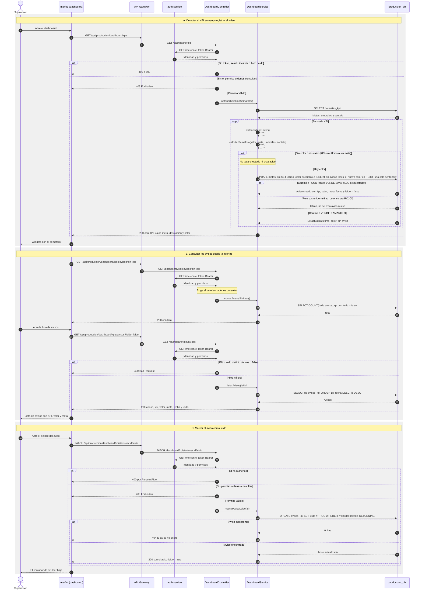

# ABC-502: secuencia del aviso de KPI en rojo

Diagrama de secuencia de la detección de un KPI en rojo, el registro del aviso y su lectura desde la interfaz. Corresponde a la subtarea **ABC-502** de la historia **ABC-425** y se elaboró junto con **ABC-500** (detección y registro) y **ABC-526** (contador de avisos sin leer).

---

## 1. Objetivo y alcance

- **Objetivo:** mostrar cómo el cálculo del semáforo genera un aviso cuando un KPI pasa a rojo, y cómo el Supervisor lo consulta y lo marca como leído.
- **Incluido:** cálculo del KPI y del semáforo, registro del aviso, rojo sostenido sin aviso nuevo, contador y listado de avisos, y marca de leído.
- **No incluido:** la configuración de metas y umbrales (ver `meta-y-semaforo.md`, ABC-498) y el cálculo de cada KPI (hoy solo `FPY` devuelve valor; ver `kpi-fpy.md`).
- **Frontend:** en el repositorio aún no existe una pantalla que consuma los endpoints de avisos. La participación de la interfaz es la prevista y debe revisarse cuando se implemente.
- **Servicios:** el diagrama traza `produccion-service`. `logistica-service` expone los mismos endpoints con sus propios KPI.

---

## 2. Reglas de negocio y respuestas HTTP

| Regla | Condición técnica | Código HTTP |
| :--- | :--- | :--- |
| **Autenticación requerida** | Token Bearer ausente, inválido o expirado | `401 Unauthorized` |
| **Auth no disponible** | `auth-service` no responde o devuelve algo inválido | `503 Service Unavailable` |
| **Autorización** | Falta el permiso `ordenes.consultar` en `GET /dashboard/kpis`, en los endpoints de avisos y en el de marca de leído | `403 Forbidden` |
| **Filtro válido** | `leido` en `GET /dashboard/kpis/avisos` no es `true` ni `false` | `400 Bad Request` |
| **Identificador válido** | `:id` de `PATCH .../avisos/:id/leido` no es un entero | `400 Bad Request` |
| **Aviso existente** | El aviso no existe o su KPI no pertenece al servicio | `404 Not Found` |
| **Operación exitosa** | Semáforo, lista, contador o aviso actualizado devueltos | `200 OK` |

### Regla del aviso

El aviso se crea solo cuando el color calculado **cambia a `ROJO`**. El último color conocido se guarda en `metas_kpi.ultimo_color`.

| Situación | Resultado |
| :--- | :--- |
| Sin color o sin valor | No cambia el estado ni crea aviso |
| Cambia a `ROJO` desde `VERDE`, `AMARILLO` o sin estado | Crea un aviso con `kpi`, `valor`, `meta`, `fecha` y `leido = false` |
| Sigue en `ROJO` (rojo sostenido) | No crea un aviso nuevo |
| Cambia a `VERDE` o `AMARILLO` | Solo actualiza `ultimo_color`; si luego vuelve a `ROJO`, se crea un aviso nuevo |

La actualización del estado y la inserción del aviso son **una sola sentencia SQL**. Si dos consultas concurrentes ven el mismo cambio, solo una cumple `IS DISTINCT FROM` y crea el aviso.

---

## 3. Diagrama de secuencia



Fuente editable: [`aviso-kpi-rojo.mmd`](aviso-kpi-rojo.mmd). Exportación: [`aviso-kpi-rojo.png`](aviso-kpi-rojo.png).

---

## 4. Trazabilidad al código

| Elemento | Archivo |
| :--- | :--- |
| Endpoints de avisos y contador | `services/produccion-service/src/dashboard/dashboard.controller.ts` |
| Detección (`registrarAvisoSiCambioARojo`), listado, marca de leído y contador | `services/produccion-service/src/dashboard/dashboard.service.ts` |
| Regla del semáforo | `services/produccion-service/src/dashboard/semaforo.ts` |
| Entidad `avisos_kpi` | `services/produccion-service/src/dashboard/entities/aviso-kpi.entity.ts` |
| Migración (`avisos_kpi` y `ultimo_color`) | `services/produccion-service/src/database/migrations/1710000000031-AvisosKpi.ts` |
| Pruebas con PostgreSQL real | `services/produccion-service/src/dashboard/dashboard.avisos.integracion.spec.ts` |

## 5. Regenerar la exportación

```powershell
cd docs/diagramas/sprint-4/secuencia
npx @mermaid-js/mermaid-cli -i aviso-kpi-rojo.mmd -o aviso-kpi-rojo.png -c ../../sprint-3/mermaid-integraciones.config.json -b white -s 2
```
