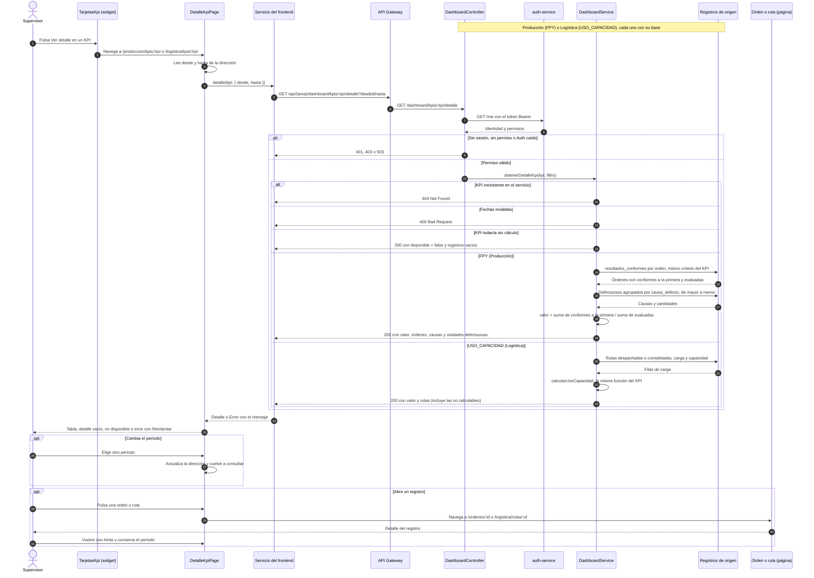

# ABC-514: secuencia del detalle de un KPI

Apertura del detalle de un KPI y navegación hacia la orden o ruta. Subtarea **ABC-514** de la historia **ABC-428**, elaborada junto con **ABC-512** (endpoint) y **ABC-513** (pantalla).

## Alcance

- Con detalle hoy: **FPY** y **USO_CAPACIDAD**, los únicos KPIs con cálculo. Los otros seis responden `disponible: false` hasta que exista su cálculo; cada uno se conecta en `obtenerDetalleKpi`.
- Las tarjetas muestran el valor de todo el historial, igual que el semáforo, y abren el detalle sin periodo. El detalle admite `?desde&hasta` en la dirección.
- El detalle usa el mismo criterio que el KPI (`COLUMNAS_FPY` y `calcularUsoCapacidad`), por eso el valor coincide.

## Diagrama

Fuente editable: [`detalle-kpi.mmd`](detalle-kpi.mmd). Exportación: [`detalle-kpi.png`](detalle-kpi.png).

## Trazabilidad al código

| Elemento | Archivo |
| :--- | :--- |
| Endpoint y cálculo | `services/{produccion,logistica}-service/src/dashboard/dashboard.{controller,service}.ts` |
| Tarjetas con semáforo | `frontend/src/components/kpis/TarjetasKpi.jsx` |
| Pantalla de detalle | `frontend/src/pages/DetalleKpiPage.jsx` |
| Servicios del frontend | `frontend/src/services/kpis.js`, `dashboardService.js`, `dashboardLogisticaService.js` |
| Pruebas | `dashboard.service.spec.ts`, `dashboard.http.spec.ts`, `dashboard.detalle-kpi.integracion.spec.ts`, `frontend/scripts/kpis.test.mjs` |
