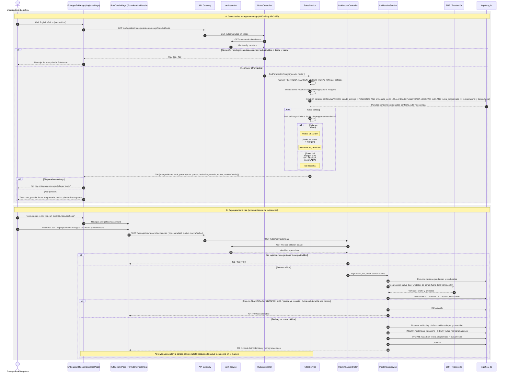

# ABC-460: secuencia de las entregas en riesgo y el acceso a reprogramar

Diagrama de secuencia de la consulta de las paradas en riesgo de llegar tarde y
del acceso a reprogramar su ruta. Corresponde a la subtarea **ABC-460** de la
historia **ABC-415** y se elaboró junto con **ABC-458** (endpoint en
`logistica-service`) y **ABC-459** (vista en el frontend). Lo entregado se
distingue con la hora real de entrega de **ABC-414** (`rutas_paradas.entregada_en`).

Fuente: [`entregas-en-riesgo.mmd`](entregas-en-riesgo.mmd) · Exportación:
[`entregas-en-riesgo.png`](entregas-en-riesgo.png)

---

## 1. Alcance

- **Incluido:** `GET /rutas/paradas-en-riesgo` (`RutasService.findParadasEnRiesgo`),
  la vista `EntregasEnRiesgo` en `LogisticaPage` y el acceso a reprogramar, que
  reutiliza `POST /rutas/:id/incidencias` con `nuevaFecha` (`IncidenciasService.registrar`).
- **No incluido:** el detalle interno de la validación de recursos al reprogramar
  (solapes y capacidad, ABC-371), que ya está documentado con las rutas.

## 2. Reglas que muestra el diagrama

| Regla | Dónde está |
| --- | --- |
| La hora programada es el fin del día programado en Bolivia (UTC-4) | `limiteEntrega` en `despacho/retraso-entrega.ts` (ABC-524) |
| En riesgo = parada `PENDIENTE` de ruta `PLANIFICADA` o `DESPACHADA` cuyo límite ya pasó (`VENCIDA`) o llega dentro del margen (`POR_VENCER`) | `evaluarRiesgo` en `rutas/riesgo-entrega.ts` |
| El margen se configura con `ENTREGA_MARGEN_RIESGO_HORAS` (0 a 720; 24 h por defecto) | `margenRiesgoHoras` en `rutas/riesgo-entrega.ts` |
| Las paradas `ENTREGADA` (con `entregada_en`) o `ANULADA` no aparecen | SQL de `findParadasEnRiesgo` y `evaluarRiesgo` |
| Consultar exige `logistica.rutas.consultar`; `desde`/`hasta` deben ser fechas `YYYY-MM-DD` válidas | `RutasController` y `validarFiltroParadasRiesgo` |
| Reprogramar exige `logistica.rutas.gestionar`, una ruta activa y una fecha futura distinta | `IncidenciasService.registrar` |
| Sin `logistica.rutas.gestionar` el acceso de la fila es "Ver ruta" | `EntregasEnRiesgo.jsx` |

---

## 3. Diagrama



## 4. Exportación

Desde `docs/diagramas/sprint-4/secuencia`, con `mermaid-cli` (mismo procedimiento
que `docs/diagramas/sprint-3/README.md`):

```powershell
npx @mermaid-js/mermaid-cli -i entregas-en-riesgo.mmd -o entregas-en-riesgo.png -b white -s 2
```
