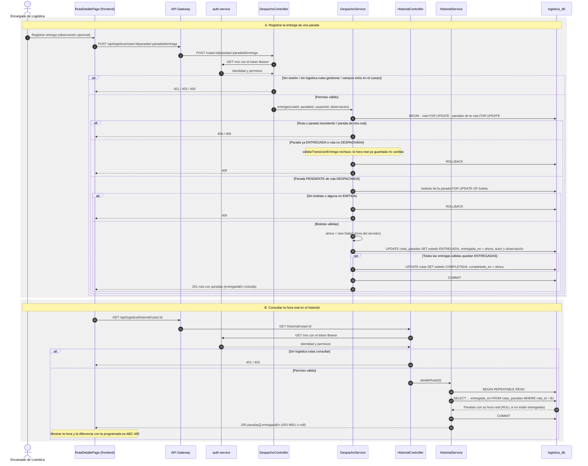

# ABC-456: secuencia de la hora real de entrega

Diagrama de secuencia del registro de la hora real al marcar una entrega y de su
consulta en el historial logístico. Corresponde a la subtarea **ABC-456** de la
historia **ABC-414** y se elaboró junto con **ABC-454**, que implementó el
registro en `logistica-service`. El campo `rutas_paradas.entregada_en` lo agregó
**ABC-453** (migración `1710000000016`).

Fuente: [`hora-real-entrega.mmd`](hora-real-entrega.mmd) · Exportación:
[`hora-real-entrega.png`](hora-real-entrega.png)

---

## 1. Alcance

- **Incluido:** `POST /rutas/:id/paradas/:paradaId/entrega` (`DespachoService.entregar`)
  y `GET /historial/rutas/:id` (`HistorialService.detalleRuta`).
- **No incluido:** mostrar la hora en pantalla y su diferencia con la hora
  programada (**ABC-455**) ni el motivo de retraso (CA-06).

## 2. Reglas que muestra el diagrama

| Regla | Dónde está |
| --- | --- |
| La hora es la del servidor (`new Date()`), no la del cliente | `despacho.service.ts`, `entregar` |
| Una parada ya `ENTREGADA` no se vuelve a entregar: 409 y la hora no cambia | `validarTransicionEntrega` (ABC-375) |
| Solo una parada `ENTREGADA` puede tener `entregada_en` | CHECK `ck_ruta_parada_entregada_en` (ABC-453) |
| El historial expone `entregadaEn` en ISO 8601, o `null` si la parada no está entregada | `historial.service.ts`, `detalleRuta` |

---

## 3. Diagrama



## 4. Exportación

Desde `docs/diagramas/sprint-4/secuencia`, con `mermaid-cli` (mismo procedimiento
que `docs/diagramas/sprint-3/README.md`):

```powershell
npx @mermaid-js/mermaid-cli -i hora-real-entrega.mmd -o hora-real-entrega.png -b white -s 2
```
