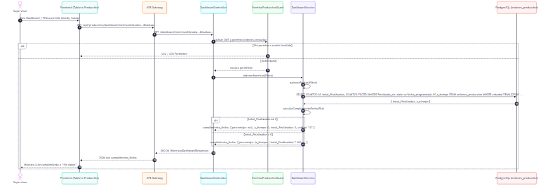
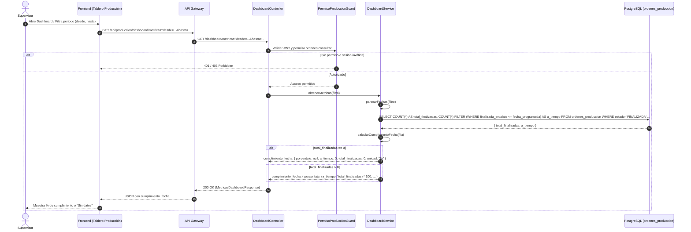

# Diagrama de secuencia — KPI Cumplimiento de Fecha Requerida (ABC-464 / ABC-416)

Flujo de consulta del KPI **Cumplimiento de Fecha** (`CUMPLIMIENTO_FECHA`) desde el tablero de Producción hasta la base de datos PostgreSQL, verificando permisos (`ordenes.consultar`), filtrando órdenes `FINALIZADA` por rango de fechas y devolviendo `null` (*"Sin datos"*) cuando no existen órdenes finalizadas en el período.

