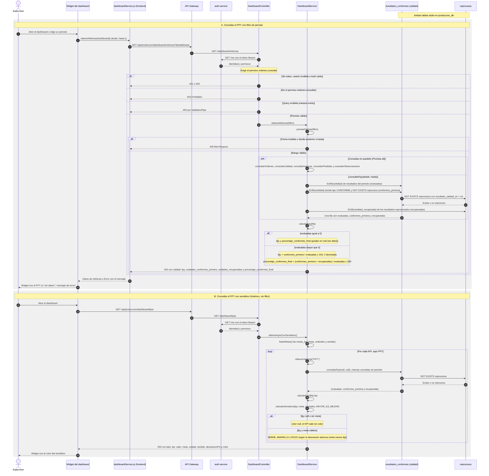

# ABC-472: secuencia del cálculo y la consulta del FPY

Diagrama de secuencia del cálculo y la consulta del FPY (First Pass Yield, porcentaje de unidades conformes a la primera, sin reprocesos). Corresponde a la subtarea **ABC-472** de la historia **ABC-418** y se elaboró junto con **ABC-470**, que implementó el cálculo en `produccion-service`.

---

## 1. Alcance

- **Incluido:** consulta de métricas con filtro de periodo (`GET /dashboard/metricas`), cálculo del FPY excluyendo reprocesos y consulta del semáforo (`GET /dashboard/kpis`).
- **No incluido:** la configuración de metas y umbrales (ver `meta-y-semaforo.md`, ABC-498).
- **Frontend:** el servicio `obtenerMetricasDashboard` ya existe. El widget del FPY en producción aún no existe en el repositorio, por lo que su participación en el diagrama es la prevista y debe revisarse cuando se implemente.

## 2. Regla del FPY (ABC-470)

| Dato | Definición |
| :--- | :--- |
| `evaluadas` | Suma de `cantidad` de `resultados_conformes` del periodo |
| `conformes_primera` | Suma de `cantidad` con `tipo = 'CONFORME'` y sin ningún registro en `reprocesos` para ese resultado |
| `recuperadas` | Suma de `cantidad_recuperada` de los `reprocesos` de esos resultados |
| `fpy` | `conformes_primera / evaluadas × 100`, 2 decimales; `null` si `evaluadas = 0` |
| `porcentaje_conformes_final` | `(conformes_primera + recuperadas) / evaluadas × 100`; `null` si `evaluadas = 0` |

Una unidad que pasó por reproceso no cuenta como conforme a la primera; las recuperadas se informan aparte.

---

## 3. Diagrama



Fuente editable: [`kpi-fpy.mmd`](kpi-fpy.mmd). Exportación: [`kpi-fpy.png`](kpi-fpy.png).

---

## 4. Trazabilidad al código

| Elemento | Archivo |
| :--- | :--- |
| Endpoints `metricas` y `kpis` | `services/produccion-service/src/dashboard/dashboard.controller.ts` |
| `consultarFpy`, `calcularFpy`, `obtenerValorKpi` y `obtenerKpisConSemaforo` | `services/produccion-service/src/dashboard/dashboard.service.ts` |
| Campos `fpy`, `unidades_conformes_primera`, `unidades_recuperadas` y `porcentaje_conformes_final` | `services/produccion-service/src/dashboard/dashboard.interface.ts` |
| Regla del semáforo | `services/produccion-service/src/dashboard/semaforo.ts` |
| Servicio del frontend | `frontend/src/services/dashboardService.js` |
| Permisos y sesión | `services/produccion-service/src/auth/permiso-produccion.guard.ts` |

## 5. Regenerar la exportación

```powershell
cd docs/diagramas/sprint-4/secuencia
npx @mermaid-js/mermaid-cli -i kpi-fpy.mmd -o kpi-fpy.png -c ../../sprint-3/mermaid-integraciones.config.json -b white -s 2
```
