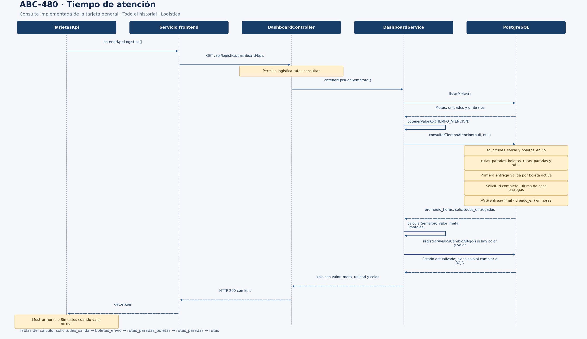

# ABC-480 — Secuencia del tiempo de atención

Responsable: Andrea Narváez. Fecha: 23 de noviembre de 2026.

El diagrama representa el recorrido implementado de la tarjeta genérica de KPI de Logística, que consulta todo el historial, y el cálculo incorporado en ABC-478. PostgreSQL agrupa las solicitudes de salida y sus paradas mediante las boletas. Se muestran cinco participantes; las tablas se detallan dentro de PostgreSQL.

[Fuente Mermaid editable](kpi-tiempo-atencion.mmd).

## Correspondencia con el código

| Participante | Archivo o recurso real |
|---|---|
| Tarjeta | `frontend/src/components/kpis/TarjetasKpi.jsx`, usa `AREAS_KPI.logistica.listar` y formatea horas o «Sin datos» |
| Servicio frontend | `frontend/src/services/dashboardLogisticaService.js`, función `obtenerKpisLogistica`, seleccionada desde `services/kpis.js` |
| Controlador | `services/logistica-service/src/dashboard/dashboard.controller.ts`, `obtenerKpis`, con `logistica.rutas.consultar` |
| Servicio | `services/logistica-service/src/dashboard/dashboard.service.ts`, `obtenerKpisConSemaforo`, `obtenerValorKpi`, `consultarTiempoAtencion` y semáforo existente |
| Solicitudes y paradas | Tablas `solicitudes_salida`, `boletas_envio`, `rutas_paradas_boletas`, `rutas_paradas` y `rutas` |

La comprobación del aviso no crea uno en cada consulta: se registra solo al cambiar a rojo. Si el valor o color es nulo, no se actualiza el aviso. Se omiten los otros KPI para mantener el diagrama centrado en tiempo de atención.

## Consulta con periodo

`WidgetsDashboardLogistica` ya consulta `obtenerMetricasDashboardLogistica({ desde, hasta })`. Ese servicio usa `GET /api/logistica/dashboard/metricas`; el controlador llama a `obtenerMetricas` y este ejecuta `consultarTiempoAtencion(fechaDesde, fechaHasta)` junto con las demás métricas. La respuesta incorpora `tiempo_atencion`, con promedio y cantidad. El filtro se aplica a la entrega final de la solicitud; las fechas simples son días UTC inclusivos.

La visualización de ese campo y el retiro del widget anterior corresponden a **ABC-479**, todavía pendiente. Por eso el diagrama representa la tarjeta genérica que ya existe y no presenta ese reemplazo como terminado.

## Reglas y límites

- Cada solicitud completa cuenta una vez. Se toma la primera entrega válida de cada boleta activa y la última de esas horas completa la solicitud.
- Horas ausentes o anteriores a la solicitud, entregas pendientes/anuladas y rutas canceladas/planificadas no aportan al cálculo. Una boleta activa sin entrega válida mantiene incompleta la solicitud.
- Sin observaciones válidas, el valor es `null` y se muestra «Sin datos». Cero horas es un resultado válido.
- **ABC-454** debe guardar la hora real de las nuevas entregas. El diagrama inicia en la consulta y no afirma que ese registro ya esté integrado.
- El enlace al detalle de registros de tiempo de atención todavía informa que ese detalle no está disponible.

El contrato, los ejemplos y las pruebas se describen en [la evidencia de ABC-478](../../../evidencias/sprint-4/ABC-478.md).
