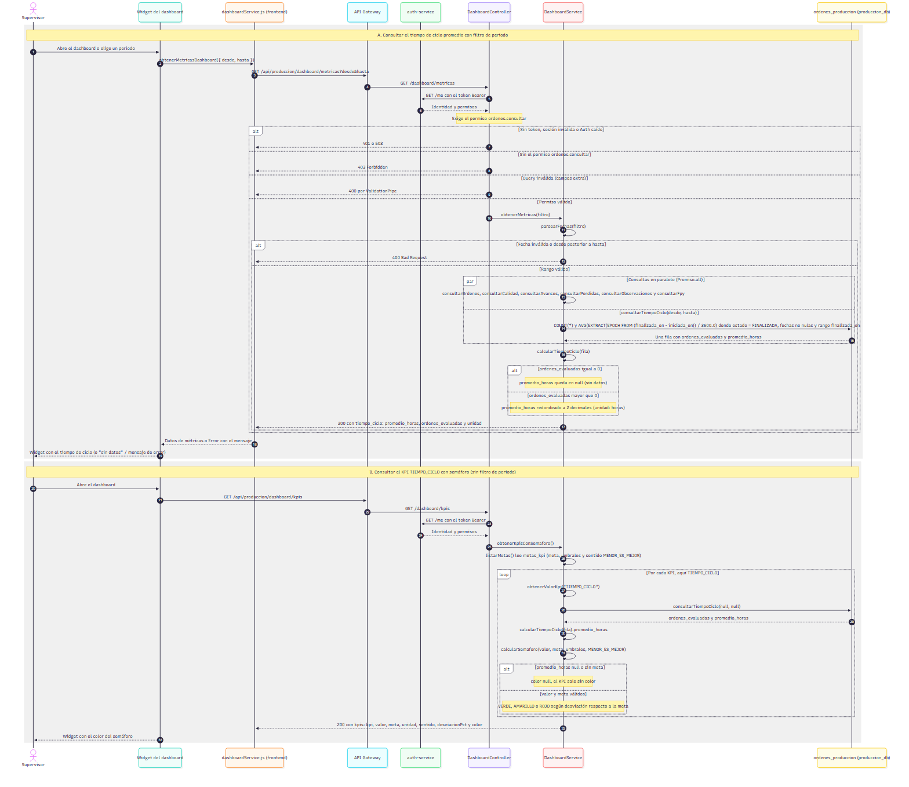
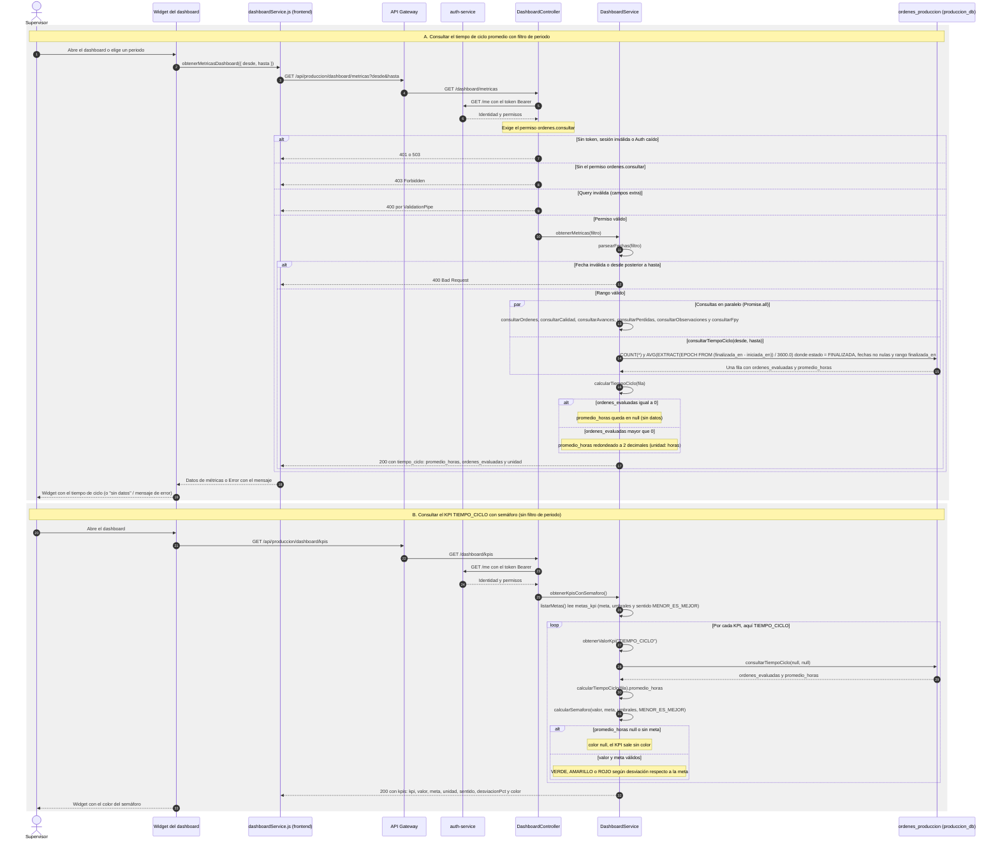

# ABC-468: secuencia del cálculo y la consulta del tiempo de ciclo

Diagrama de secuencia del cálculo y la consulta del KPI de **tiempo de ciclo promedio** de las órdenes finalizadas. Corresponde a la subtarea **ABC-468** de la historia **ABC-417** y se elaboró junto con **ABC-466**, que implementó el cálculo en `produccion-service`.

---

## 1. Alcance

- **Incluido:** consulta de métricas con filtro de periodo (`GET /dashboard/metricas`), cálculo del tiempo de ciclo en horas sobre órdenes `FINALIZADA` y consulta del semáforo (`GET /dashboard/kpis` para `TIEMPO_CICLO`).
- **No incluido:** la configuración de metas y umbrales (ver `meta-y-semaforo.md`, ABC-498).
- **Frontend:** el servicio `obtenerMetricasDashboard` ya existe en `frontend/src/services/dashboardService.js`; el widget específico del dashboard de Producción corresponde a **ABC-467**.

## 2. Regla del tiempo de ciclo (ABC-466)

| Dato | Definición |
| :--- | :--- |
| Universo | Órdenes en `ordenes_produccion` con `estado = 'FINALIZADA'`, `iniciada_en IS NOT NULL`, `finalizada_en IS NOT NULL` y `finalizada_en >= iniciada_en` |
| Filtro de periodo | `finalizada_en >= desde` y `finalizada_en <= hasta` cuando se envían en `FiltroDashboardDto` |
| `promedio_horas` | `AVG(EXTRACT(EPOCH FROM (finalizada_en - iniciada_en)) / 3600.0)` redondeado a 2 decimales; `null` (`"sin datos"`) si `ordenes_evaluadas = 0` |
| `unidad` | `'horas'` (alineado con `metas_kpi` para `TIEMPO_CICLO`, sentido `MENOR_ES_MEJOR`) |

---

## 3. Diagrama

