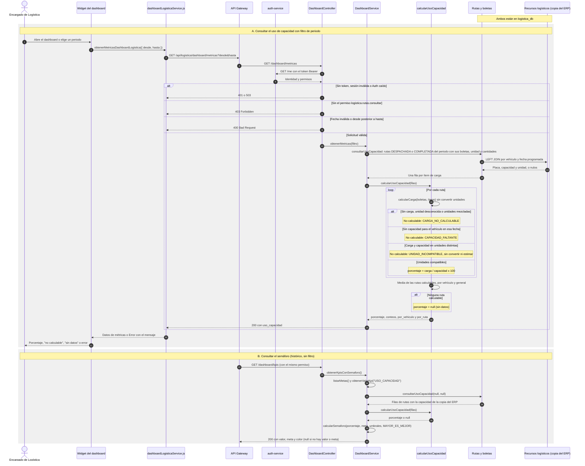

# ABC-492: secuencia del cálculo y la consulta del uso de capacidad

Diagrama de secuencia del uso de capacidad del vehículo por ruta, incluida la regla de unidades compatibles. Corresponde a la subtarea **ABC-492** de la historia **ABC-423** y se elaboró junto con **ABC-490**, que implementó el cálculo en `logistica-service`.

## 1. Alcance

- **Incluido:** `GET /dashboard/metricas` con filtro de periodo (`uso_capacidad`) y el valor de `USO_CAPACIDAD` en `GET /dashboard/kpis`.
- **No incluido:** configuración de metas y umbrales (ver `meta-y-semaforo.md`, ABC-498).
- **Frontend:** el servicio `obtenerMetricasDashboardLogistica` ya existe. El widget aún no muestra este KPI; su participación en el diagrama es la prevista y debe revisarse cuando se implemente.

## 2. Regla del cálculo (ABC-490)

| Aspecto | Regla |
| :--- | :--- |
| Rutas incluidas | `DESPACHADA` y `COMPLETADA`, por fecha programada dentro del periodo |
| Carga | Suma de los ítems de sus boletas; una boleta repetida en la ruta cuenta una vez |
| Paradas anuladas | Antes del despacho no se cargaron y no suman; después del despacho sí viajaron |
| Capacidad | La del vehículo en la copia local del ERP de la misma fecha; no se usa la de otra fecha |
| Porcentaje de la ruta | `carga / capacidad × 100`, 2 decimales, solo con la misma unidad |
| Porcentaje por vehículo y general | Media simple de los porcentajes de sus rutas calculables; `null` = sin datos |
| No calculable | `CARGA_NO_CALCULABLE`, `CAPACIDAD_FALTANTE` o `UNIDAD_INCOMPATIBLE`, con su detalle |

Se usa la media de porcentajes porque las capacidades pueden estar en unidades distintas (kg, caja) y no se pueden sumar.

## 3. Diagrama



Fuente editable: [`kpi-uso-capacidad.mmd`](kpi-uso-capacidad.mmd). Exportación: [`kpi-uso-capacidad.png`](kpi-uso-capacidad.png).

## 4. Trazabilidad al código

| Elemento | Archivo |
| :--- | :--- |
| Endpoints `metricas` y `kpis` | `services/logistica-service/src/dashboard/dashboard.controller.ts` |
| `consultarUsoCapacidad` y `obtenerValorKpi` | `services/logistica-service/src/dashboard/dashboard.service.ts` |
| `calcularUsoCapacidad` | `services/logistica-service/src/dashboard/uso-capacidad.ts` |
| `calcularCarga` | `services/logistica-service/src/rutas/validaciones/carga.ts` |
| `compararCapacidad` | `services/logistica-service/src/recursos-externos/dto/recursos-logisticos-v1.validator.ts` |
| Pruebas | `dashboard.service.spec.ts` y `dashboard.uso-capacidad.integracion.spec.ts` |

## 5. Regenerar la exportación

```powershell
cd docs/diagramas/sprint-4/secuencia
npx @mermaid-js/mermaid-cli -i kpi-uso-capacidad.mmd -o kpi-uso-capacidad.png -c ../../sprint-3/mermaid-integraciones.config.json -b white -s 2
```
