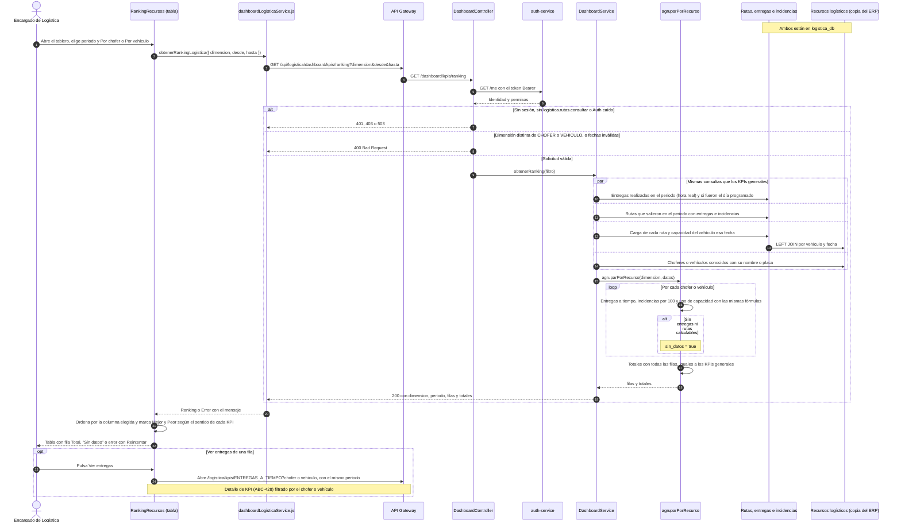

# ABC-522: secuencia de los KPIs de Logística por chofer y vehículo

Consulta del ranking que compara choferes y vehículos en puntualidad, incidencias y uso de capacidad. Subtarea **ABC-522** de la historia **ABC-430**, elaborada junto con **ABC-520** (agregación) y **ABC-531** (enlace al detalle).

## Reglas

| KPI | Fórmula | Periodo |
| :--- | :--- | :--- |
| Entregas a tiempo | Entregas hechas el día programado de la ruta o antes (hora de Bolivia) / entregas realizadas × 100 | Hora real de entrega |
| Incidencias por 100 entregas | Incidencias registradas en rutas que salieron / paradas no anuladas de esas rutas × 100 | Fecha programada de la ruta |
| Uso de capacidad | Media de las rutas calculables (ver `kpi-uso-capacidad.md`) | Fecha programada de la ruta |

- No existe una hora programada por parada; la puntualidad se mide por el día programado de la ruta (decisión de la Product Owner).
- Cada grupo usa las mismas funciones que el KPI general. Los conteos de los grupos suman los del total, y la fila Total es exactamente el KPI general del periodo.
- Un chofer o vehículo de la copia del ERP sin entregas ni rutas calculables en el periodo aparece como "Sin datos".
- Mejor y peor se marcan con texto en cada columna: más es mejor en puntualidad y uso; menos es mejor en incidencias.

## Diagrama

Fuente editable: [`kpis-por-chofer-vehiculo.mmd`](kpis-por-chofer-vehiculo.mmd). Exportación: [`kpis-por-chofer-vehiculo.png`](kpis-por-chofer-vehiculo.png).

## Trazabilidad al código

| Elemento | Archivo |
| :--- | :--- |
| Endpoint `GET /dashboard/kpis/ranking` | `services/logistica-service/src/dashboard/dashboard.controller.ts` |
| `obtenerRanking`, `consultarEntregasRealizadas`, `consultarIncidenciasPorRuta` | `services/logistica-service/src/dashboard/dashboard.service.ts` |
| `agruparPorRecurso` y fórmulas | `services/logistica-service/src/dashboard/kpis-recurso.ts` |
| Tabla ordenable | `frontend/src/components/logistica/dashboard/RankingRecursos.jsx` |
| Pruebas | `dashboard.ranking.integracion.spec.ts`, `frontend/scripts/dashboard-logistica.test.mjs` |
