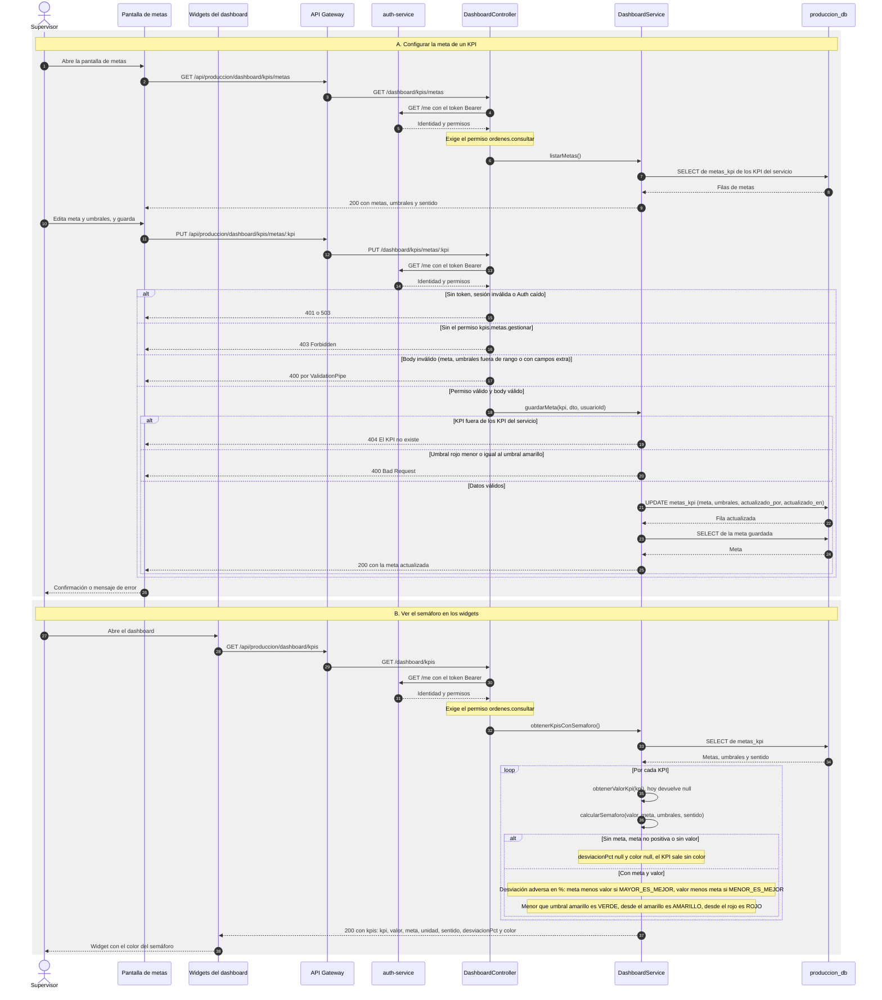

# ABC-498: secuencia de metas de KPI y semáforo

Diagrama de secuencia de la configuración de metas y del cálculo del semáforo. Corresponde a la subtarea **ABC-498** de la historia **ABC-424** y se elaboró junto con **ABC-495**, con la entidad de **ABC-494**.

---

## 1. Objetivo y alcance

- **Objetivo:** mostrar cómo el Supervisor define la meta y los umbrales de un KPI, y cómo los widgets del dashboard obtienen el color del semáforo.
- **Incluido:** consulta y guardado de metas, validación de permisos y datos, y la regla del semáforo.
- **No incluido:** el cálculo del valor de cada KPI. Cada historia de KPI lo conecta en `obtenerValorKpi`, que hoy devuelve `null`, así que los KPI salen sin color hasta entonces.
- **Servicios:** el diagrama traza `produccion-service`. `logistica-service` expone los mismos endpoints con sus propios KPI.

| Servicio | KPI administrados |
| :--- | :--- |
| `produccion-service` | `CUMPLIMIENTO_FECHA`, `TIEMPO_CICLO`, `FPY`, `MERMA` |

---

## 2. Reglas de negocio y respuestas HTTP

| Regla | Condición técnica | Código HTTP |
| :--- | :--- | :--- |
| **Autenticación requerida** | Token Bearer ausente, inválido o expirado | `401 Unauthorized` |
| **Auth no disponible** | `auth-service` no responde o devuelve algo inválido | `503 Service Unavailable` |
| **Autorización para consultar** | Falta el permiso `ordenes.consultar` en `GET /dashboard/kpis` y `GET /dashboard/kpis/metas` | `403 Forbidden` |
| **Autorización para configurar** | Falta el permiso `kpis.metas.gestionar` en `PUT /dashboard/kpis/metas/:kpi` | `403 Forbidden` |
| **Estructura del payload** | `meta` no es null ni un número positivo de hasta 4 decimales, o los umbrales son negativos, tienen más de 2 decimales o sobran campos | `400 Bad Request` |
| **Umbrales coherentes** | El umbral rojo es menor o igual al umbral amarillo | `400 Bad Request` |
| **KPI existente** | El KPI no pertenece al servicio | `404 Not Found` |
| **Operación exitosa** | Meta guardada y devuelta con `actualizadoPor` y `actualizadoEn` | `200 OK` |

### Regla del semáforo

La desviación adversa es el porcentaje en que el valor queda peor que la meta: `(meta - valor) / meta` si el KPI es `MAYOR_ES_MEJOR` y `(valor - meta) / meta` si es `MENOR_ES_MEJOR`.

| Desviación | Color |
| :--- | :--- |
| Menor que el umbral amarillo | `VERDE` |
| Desde el umbral amarillo y menor que el rojo | `AMARILLO` |
| Desde el umbral rojo | `ROJO` |
| Sin meta, meta no positiva o sin valor | sin color (`null`) |

---

## 3. Diagrama de secuencia



Fuente editable: [`meta-y-semaforo.mmd`](meta-y-semaforo.mmd). Exportación: [`meta-y-semaforo.png`](meta-y-semaforo.png).

---

## 4. Trazabilidad al código

| Elemento | Archivo |
| :--- | :--- |
| Endpoints | `services/produccion-service/src/dashboard/dashboard.controller.ts` |
| Guardado de metas y `GET /dashboard/kpis` | `services/produccion-service/src/dashboard/dashboard.service.ts` |
| Regla del semáforo | `services/produccion-service/src/dashboard/semaforo.ts` |
| Validación del body | `services/produccion-service/src/dashboard/dto/guardar-meta-kpi.dto.ts` |
| Entidad `metas_kpi` | `services/produccion-service/src/dashboard/entities/meta-kpi.entity.ts` |
| Permisos y sesión | `services/produccion-service/src/auth/permiso-produccion.guard.ts` |

## 5. Regenerar la exportación

```powershell
cd docs/diagramas/sprint-4/secuencia
npx @mermaid-js/mermaid-cli -i meta-y-semaforo.mmd -o meta-y-semaforo.png -c ../../sprint-3/mermaid-integraciones.config.json -b white -s 2
```
