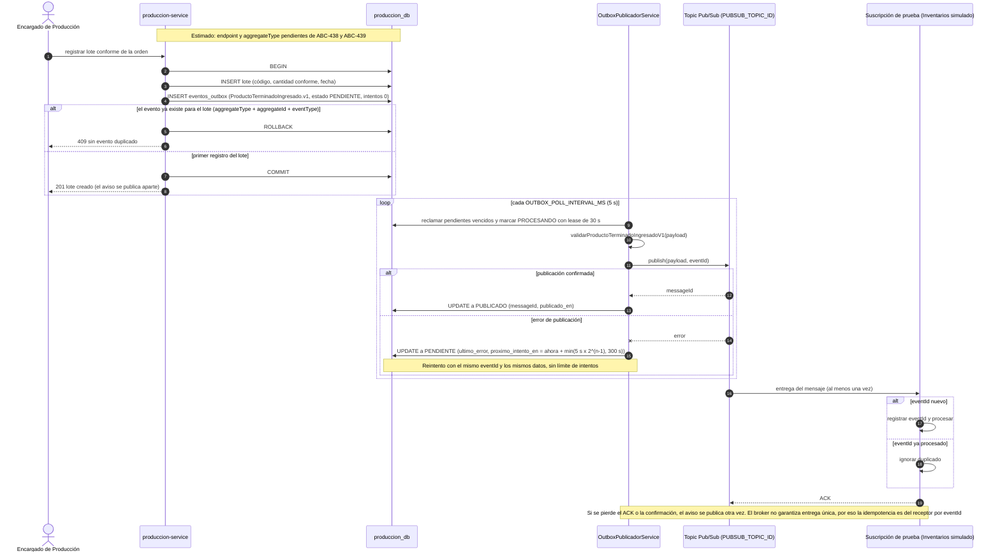

# ABC-441: secuencia del aviso ProductoTerminadoIngresado

Diagrama de secuencia del aviso asíncrono que `produccion-service` envía a Inventarios cuando un lote conforme queda terminado. Corresponde a la subtarea **ABC-441** de la historia **ABC-411** y se elaboró junto con **ABC-438** y **ABC-439**. El contrato está en `docs/integraciones/producto-terminado-ingresado-v1.md`.

> **Estado: borrador estimado.** ABC-438 y ABC-439 aún no existen. Los estados y la política de reintento salen del outbox ya implementado en `services/produccion-service/src/integraciones/outbox/`. El endpoint de creación del lote y el `aggregateType` son una estimación y deben revisarse cuando esas tareas se integren.

---

## 1. Alcance

- **Incluido:** creación del lote, escritura en el outbox, publicación, reintento, idempotencia y suscripción de prueba.
- **No incluido:** el registro real del producto en Inventarios. Inventarios no es real; se prueba con una suscripción de prueba en el emulador.

---

## 2. Estados del aviso (`eventos_outbox.estado`)

| Estado | Significado | Origen |
| :--- | :--- | :--- |
| `PENDIENTE` | Creado con el lote, o devuelto tras un fallo, a la espera de `proximo_intento_en` | Código existente |
| `PROCESANDO` | Reclamado por un publicador con lease (`OUTBOX_LEASE_MS`, 30 s) | Código existente |
| `PUBLICADO` | El topic confirmó con un `messageId` | Código existente |

No hay un estado de fallo definitivo: un error vuelve el aviso a `PENDIENTE` y guarda `ultimo_error`.

## 3. Reintento

| Parámetro | Valor por defecto | Variable |
| :--- | :--- | :--- |
| Espera inicial | 5 s | `OUTBOX_RETRY_BASE_MS` |
| Espera máxima | 300 s | `OUTBOX_RETRY_MAX_MS` |
| Fórmula | `min(base × 2^(intentos-1), máximo)` | — |
| Frecuencia de sondeo | 5 s | `OUTBOX_POLL_INTERVAL_MS` |
| Lote por ciclo | 20 | `OUTBOX_BATCH_SIZE` |
| Límite de intentos | Ninguno | — |

## 4. Idempotencia y entrega

- Un reintento conserva el mismo `eventId` y los mismos datos del lote.
- Un índice único (`aggregateType`, `aggregateId`, `eventType`) evita dos avisos para el mismo lote.
- La entrega es **al menos una vez**: el broker no garantiza entrega única. El receptor debe ignorar un `eventId` ya procesado.

---

## 5. Diagrama

Fuente: [`producto-terminado-ingresado.mmd`](producto-terminado-ingresado.mmd). Exportación: [`producto-terminado-ingresado.png`](producto-terminado-ingresado.png).

