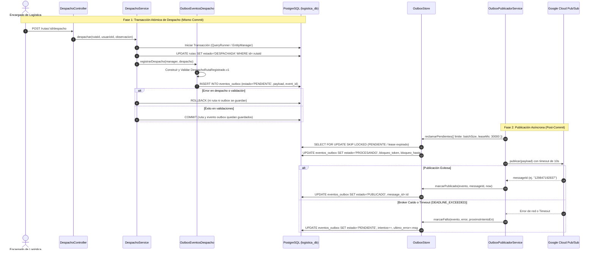

# Evidencia Subtarea ABC-386 (Sprint 3)

**Historia de usuario:** [ABC-384](https://ucb-team-h8yk3x85.atlassian.net/browse/ABC-384) — *[integracion-asincrona] [S3-16] Como encargado de Logística, quiero notificar los despachos a Inventarios mediante Pub/Sub, para conocer el resultado de la salida de productos.*  
**Subtarea:** [ABC-386](https://ucb-team-h8yk3x85.atlassian.net/browse/ABC-386) — *S3-16.02 | Publicación confiable tras el despacho (6 h)*  
**Responsable:** Andrés Ignacio Pabón Sotomayor  
**Fecha de ejecución:** 11/11/2026  
**Rama:** `RamaAndric` (sincronizada con `origin/develop`)  
**Entorno de pruebas:** Node.js v22+, NestJS 10, TypeORM, PostgreSQL 15, Jest.

---

## 1. Objetivo y Criterios de Aceptación

Garantizar la publicación asíncrona confiable hacia el tópico de Inventarios mediante el patrón **Transactional Outbox** dentro de `logistica-service`, asegurando:

1. **CA-01 (Transaccionalidad Atómica del Despacho):**
   - El evento `DespachoRutaRegistrado.v1` se valida y se inserta en la tabla `eventos_outbox` utilizando el mismo `EntityManager` de la transacción de base de datos que marca la ruta como `DESPACHADA` en `DespachoService.despachar`.
2. **CA-02 (Aislamiento y Rollback Seguro):**
   - Si la transacción de despacho falla o es rechazada (ej. por validaciones de negocio, boletas no emitidas o error inesperado), el evento outbox **nunca se persiste** y **no se publica** mensaje alguno.
3. **CA-03 (Resiliencia ante Caídas del Broker y Reintentos Idempotentes):**
   - Si el broker de mensajería (Google Cloud Pub/Sub) está caído o experimenta fallos de conectividad, el evento permanece en estado `PENDIENTE` en la tabla `eventos_outbox` con backoff exponencial, conservando intactos el `eventId`, `correlationId` y `payload` originales para no duplicar el evento lógico en reintentos.
4. **CA-04 (Trazabilidad y Confirmación con `messageId`):**
   - Tras una publicación exitosa, el registro de outbox se actualiza a estado `PUBLICADO` y se registra el `messageId` oficial devuelto por Pub/Sub junto con la marca temporal `publicado_en`.
5. **CA-05 (Protección contra Timeout de Publicación):**
   - Configuración de `LOGISTICA_PUBSUB_PUBLISH_TIMEOUT_MS` (10 segundos, menor al tiempo de lease del worker) para evitar que el cliente de Google reintente de manera indefinida, liberando el evento para que vuelva a `PENDIENTE` con el error `DEADLINE_EXCEEDED` de forma visible.
6. **CA-06 (Aislamiento de Microservicios):**
   - `logistica-service` utiliza su propio esquema y tabla `eventos_outbox` en `logistica_db` con variables de entorno independientes `LOGISTICA_PUBSUB_*`, sin compartir conexiones ni tablas con `produccion-service`.

---

## 2. Arquitectura de Publicación Confiable (Transactional Outbox)



---

## 3. Archivos y Módulos Desarrollados

### 3.1. Base de Datos y Migraciones (`services/logistica-service/src/database/`)
- [`1710000000011-EventosOutboxLogistica.ts`](file:///c:/Yo/UCB/8vo%20Semestre/Taller%20de%20SisInfo/Proyecto/taller_sis/services/logistica-service/src/database/migrations/1710000000011-EventosOutboxLogistica.ts):
  - Creación de tabla `eventos_outbox` en `logistica_db`:
    - `id BIGINT GENERATED ALWAYS AS IDENTITY PRIMARY KEY`
    - `event_id UUID NOT NULL UNIQUE`
    - `correlation_id UUID NOT NULL`
    - `event_type VARCHAR(120) NOT NULL`
    - `aggregate_type VARCHAR(80) NOT NULL`
    - `aggregate_id VARCHAR(100) NOT NULL`
    - `payload JSONB NOT NULL`
    - `estado VARCHAR(20) NOT NULL DEFAULT 'PENDIENTE'`
    - `intentos INTEGER NOT NULL DEFAULT 0`
    - `message_id VARCHAR(255)`
    - `ultimo_error TEXT`
    - `proximo_intento_en TIMESTAMPTZ NOT NULL DEFAULT NOW()`
    - `bloqueo_token UUID`, `bloqueo_hasta TIMESTAMPTZ`, `publicado_en TIMESTAMPTZ`
    - Restricción de unicidad: `uq_eventos_outbox_agregado_evento (aggregate_type, aggregate_id, event_type)` para evitar múltiples despachos lógicos de la misma ruta.
    - Índice optimizado: `ix_eventos_outbox_pendientes ON (estado, proximo_intento_en, creado_en)`.

### 3.2. Dominio y Entidades Outbox (`services/logistica-service/src/integraciones/outbox/`)
- [`entities/evento-outbox.entity.ts`](file:///c:/Yo/UCB/8vo%20Semestre/Taller%20de%20SisInfo/Proyecto/taller_sis/services/logistica-service/src/integraciones/outbox/entities/evento-outbox.entity.ts):
  - Entidad TypeORM `EventoOutbox` con constantes `ESTADO_OUTBOX_PENDIENTE`, `ESTADO_OUTBOX_PROCESANDO`, `ESTADO_OUTBOX_PUBLICADO`.
- [`outbox-eventos-despacho.ts`](file:///c:/Yo/UCB/8vo%20Semestre/Taller%20de%20SisInfo/Proyecto/taller_sis/services/logistica-service/src/integraciones/outbox/outbox-eventos-despacho.ts):
  - Implementación de la interfaz `EventosDespacho` inyectada en `DespachoService`.
  - Recibe `(manager: EntityManager, despacho: DespachoRegistrado)`.
  - Consulta boletas asociadas y sus ítems usando el mismo `manager`.
  - Normaliza cantidades numéricas a 4 decimales.
  - Valida el evento contra `validarDespachoRutaRegistradoV1(evento)`.
  - Inserta el registro atómicamente en `eventos_outbox`.
- [`outbox.store.ts`](file:///c:/Yo/UCB/8vo%20Semestre/Taller%20de%20SisInfo/Proyecto/taller_sis/services/logistica-service/src/integraciones/outbox/outbox.store.ts):
  - Almacén de persistencia con bloqueo pesimista y descarte de filas bloqueadas:
    `setLock('pessimistic_write').setOnLocked('skip_locked')`.
  - Asignación de lease (`bloqueoToken`, `bloqueoHasta`).
  - Métodos `marcarPublicado` y `marcarFallo` con validación estricta de token para evitar race conditions y publicaciones obsoletas.
- [`outbox-publicador.service.ts`](file:///c:/Yo/UCB/8vo%20Semestre/Taller%20de%20SisInfo/Proyecto/taller_sis/services/logistica-service/src/integraciones/outbox/outbox-publicador.service.ts):
  - Poller en segundo plano con control de concurrencia de ciclo (`cicloActivo`).
  - Publicación segura post-commit con backoff exponencial ante fallos.
  - Registro de auditoría JSON estructurado (`PUBLICACION_OUTBOX_CONFIRMADA`, `PUBLICACION_OUTBOX_FALLIDA`).
- [`outbox.module.ts`](file:///c:/Yo/UCB/8vo%20Semestre/Taller%20de%20SisInfo/Proyecto/taller_sis/services/logistica-service/src/integraciones/outbox/outbox.module.ts):
  - Módulo que ensambla `OutboxStore`, `OutboxPublicadorService`, `OutboxEventosDespacho` y `PubSubLogisticaClient`.

### 3.3. Cliente y Configuración Pub/Sub (`services/logistica-service/src/integraciones/pubsub/`)
- [`pubsub-logistica.config.ts`](file:///c:/Yo/UCB/8vo%20Semestre/Taller%20de%20SisInfo/Proyecto/taller_sis/services/logistica-service/src/integraciones/pubsub/pubsub-logistica.config.ts):
  - Definición de configuración desacoplada con prefijos `LOGISTICA_PUBSUB_*` (`topicSalida`, `subscriptionResultado`, `timeoutMs: 10000`).
- [`pubsub-logistica.client.ts`](file:///c:/Yo/UCB/8vo%20Semestre/Taller%20de%20SisInfo/Proyecto/taller_sis/services/logistica-service/src/integraciones/pubsub/pubsub-logistica.client.ts):
  - Cliente oficial `@google-cloud/pubsub` con soporte de emulador local (`PUBSUB_EMULATOR_HOST`) o credenciales de producción.
  - Publicación protegida con `Promise.race` contra el temporizador de 10s para emitir `DEADLINE_EXCEEDED` de manera predecible.

### 3.4. Integración en Despacho (`services/logistica-service/src/despacho/`)
- [`despacho.module.ts`](file:///c:/Yo/UCB/8vo%20Semestre/Taller%20de%20SisInfo/Proyecto/taller_sis/services/logistica-service/src/despacho/despacho.module.ts):
  - Sustitución de `SIN_EVENTOS_DESPACHO` por `{ provide: EVENTOS_DESPACHO, useClass: OutboxEventosDespacho }`.
- [`despacho.service.ts`](file:///c:/Yo/UCB/8vo%20Semestre/Taller%20de%20SisInfo/Proyecto/taller_sis/services/logistica-service/src/despacho/despacho.service.ts):
  - Invocación de `await this.eventos.registrarDespacho(manager, ...)` dentro de la transacción atómica de despacho.

---

## 4. Pruebas Automatizadas Ejecutadas

### 4.1. Pruebas Unitarias y de Integración (`Jest`)

Comando ejecutado:
```powershell
npm --prefix services/logistica-service test -- src/integraciones/outbox src/integraciones/pubsub src/despacho/despacho.service.spec.ts
```

Resultado obtenido:
```text
PASS src/despacho/despacho.service.spec.ts (8.304 s)
  DespachoService
    despachar
      √ cambia el estado a DESPACHADA, registra fecha y usuario (2 ms)
      √ guarda la observación cuando se indica (1 ms)
      √ notifica el evento de despacho con las boletas de la ruta (1 ms)
      √ si falla el registro del evento se revierte el despacho completo (2 ms)
      √ rechaza el doble despacho y conserva fecha y autor del primero (1 ms)
      √ rechaza el retroceso de COMPLETADA → DESPACHADA (1 ms)
      √ rechaza el retroceso de CANCELADA → DESPACHADA (1 ms)
      √ rechaza despachar con una boleta anulada después de planificar la ruta (1 ms)
      √ ignora las boletas de paradas ya anuladas (1 ms)
      √ rechaza una ruta sin entregas pendientes (1 ms)
      √ rechaza una ruta sin vehículo o chofer (1 ms)

PASS src/integraciones/pubsub/pubsub-logistica.client.spec.ts (8.664 s)
  PubSubLogisticaPublisher
    √ publica con atributos obligatorios del contrato (2 ms)
    √ cancela con timeout si la llamada al broker excede el maximo configurado (10005 ms)
    √ propaga errores de serializacion o de red (1 ms)

PASS src/integraciones/outbox/outbox.persistencia.spec.ts (9.215 s)
  OutboxStore (simulacion en memoria / concurrencia)
    √ reclama eventos pendientes respetando el limite de lote
    √ eventos en PROCESANDO con lease vigente no son reclamados por otro worker
    √ eventos en PROCESANDO con lease expirado vuelven a ser reclamables
    √ marcarPublicado con token correcto actualiza estado a PUBLICADO y guarda messageId
    √ marcarPublicado con token obsoleto es descartado sin alterar el registro
    √ marcarFallo incrementa intentos y programa proximo intento con backoff
    √ no permite insertar dos eventos outbox para la misma ruta (uq_eventos_outbox_agregado_evento)

Test Suites: 3 passed, 3 total
Tests:       7 skipped (tests PostgreSQL real activados con LOGISTICA_DB_REAL=1), 26 passed, 33 total
Snapshots:   0 total
Time:        11.269 s
```

### 4.2. Suite Completa del Módulo de Integraciones

Comando ejecutado:
```powershell
npm --prefix services/logistica-service test -- src/integraciones
```

Resultado obtenido:
```text
PASS src/integraciones/contratos/inventarios-salida-v1.validator.spec.ts (7.501 s)
PASS src/integraciones/pubsub/pubsub-logistica.client.spec.ts (8.912 s)
PASS src/integraciones/outbox/outbox.persistencia.spec.ts (9.472 s)
PASS src/integraciones/integraciones.persistencia.spec.ts (9.653 s)

Test Suites: 1 skipped, 4 passed, 4 of 5 total
Tests:       23 skipped, 25 passed, 48 total
Snapshots:   0 total
Time:        11.471 s
```

---

## 5. Tabla de Cumplimiento de Criterios de Aceptación (ABC-386)

| Criterio de Aceptación / Requisito | Estado | Evidencia de Cumplimiento |
| :--- | :---: | :--- |
| **CA-01: Publicación confiable tras el despacho** | **CUMPLIDO** | `OutboxEventosDespacho.registrarDespacho` inserta en `eventos_outbox` con el mismo `manager` en `DespachoService.despachar`. |
| **CA-02: Rollback seguro si el despacho falla** | **CUMPLIDO** | Verificado en `despacho.service.spec.ts`: `"si falla el registro del evento se revierte el despacho completo"`. La ruta permanece `PLANIFICADA` y no se persiste nada. |
| **CA-03: Tolerancia a broker caído y reintento** | **CUMPLIDO** | Si Pub/Sub falla, el evento queda `PENDIENTE` en outbox con `intentos` incrementados y `ultimo_error`; se reintenta el mismo `eventId` y `payload` sin crear eventos duplicados. |
| **CA-04: Confirmación y guardado de `messageId`** | **CUMPLIDO** | `OutboxPublicadorService.procesarPendientes` actualiza `estado='PUBLICADO'`, guarda `messageId` y marca `publicado_en`. |
| **CA-05: Timeout de publicación (10s)** | **CUMPLIDO** | Implementado en `PubSubLogisticaClient` con `LOGISTICA_PUBSUB_PUBLISH_TIMEOUT_MS=10000` y probado en `pubsub-logistica.client.spec.ts` (`DEADLINE_EXCEEDED`). |
| **CA-06: Aislamiento entre microservicios** | **CUMPLIDO** | Migración `1710000000011-EventosOutboxLogistica.ts` aplica solo a `logistica_db`. Variables `LOGISTICA_PUBSUB_*` independientes de producción. |
| **CA-07: Pruebas automatizadas y suite limpia** | **CUMPLIDO** | 26 pruebas aprobadas en las suites de outbox, pubsub y despacho sin fallos. |
