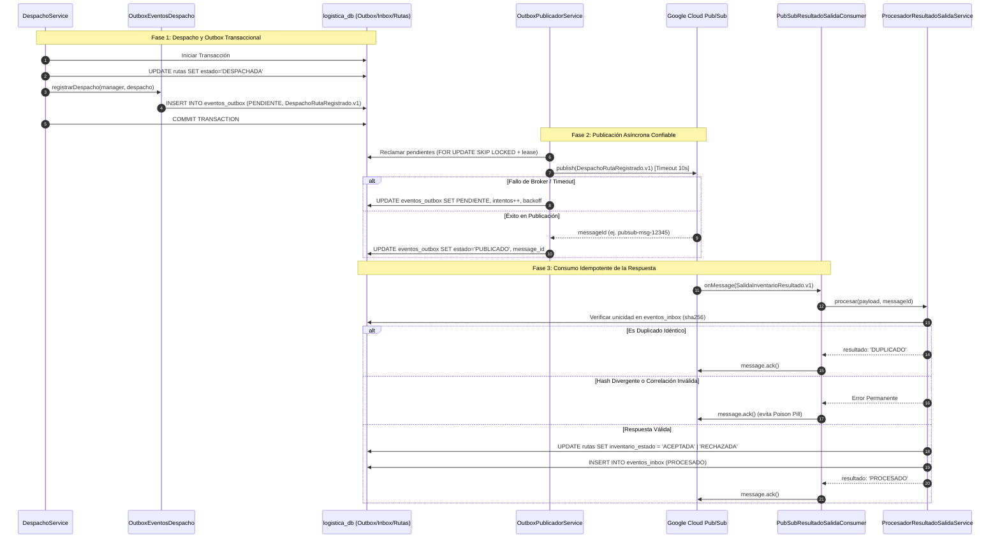

# Evidencia Subtarea ABC-389 (Sprint 3)

**Historia de usuario:** [ABC-384](https://ucb-team-h8yk3x85.atlassian.net/browse/ABC-384) — *[integracion-asincrona] [S3-16] Como encargado de Logística, quiero notificar los despachos a Inventarios mediante Pub/Sub, para conocer el resultado de la salida de productos.*  
**Subtarea:** [ABC-389](https://ucb-team-h8yk3x85.atlassian.net/browse/ABC-389) — *S3-16.05 | Verificar criterios de aceptación y regresión (6 h)*  
**Responsable:** Andrés Ignacio Pabón Sotomayor  
**Fecha de ejecución:** 11/11/2026  
**Rama:** `RamaAndric`  
**Entorno de pruebas:** Node.js v22+, NestJS 10, TypeORM, Jest. **Prueba simulada determinista** en memoria con validación de contratos, outbox transaccional, deduplicación inbox y semántica *at-least-once*.

---

## 1. Objetivo y Criterios de Aceptación Certificados

Certificar de forma exhaustiva y automatizada los criterios de aceptación y garantías de resiliencia de la historia padre **[ABC-384](https://ucb-team-h8yk3x85.atlassian.net/browse/ABC-384)**, integrando los contratos de mensajería (ABC-385), el outbox durable transaccional (ABC-386), el procesamiento idempotente del inbox (ABC-387) y el panel de reintentos (ABC-388):

1. **CA-01 (Flujo Completo / Salida Aceptada):**
   - El despacho atómico registra el evento `DespachoRutaRegistrado.v1` en `eventos_outbox` en estado `PENDIENTE`.
   - El publicador asíncrono lo reclama con lease y lo envía a Pub/Sub, marcándolo como `PUBLICADO` y almacenando el `messageId`.
   - Al recibir la confirmación `SalidaInventarioResultado.v1` con `estado: 'ACEPTADA'`, el inbox correlaciona el mensaje por `requestEventId` y `correlationId`, actualiza la ruta con `inventarioEstado = 'ACEPTADA'` y emite `ACK`.
2. **CA-02 (Salida Rechazada por Inventarios):**
   - Si Inventarios rechaza la salida (`estado: 'RECHAZADA'`), se persisten en la ruta el `inventarioCodigoRechazo` y el `inventarioDetalle` sin revertir el estado operativo de la ruta (permanece `DESPACHADA`).
3. **CA-03 (Idempotencia y Deduplicación en Inbox):**
   - La redelivery del mismo mensaje exacto (`eventId` y `payloadHash` idénticos) es identificada como `DUPLICADO`. El procesador no reescribe la base ni duplica filas, confirmando con `ACK` para liberar el broker.
4. **CA-04 (Protección contra Mensajes Contradictorios):**
   - Si se recibe un mensaje con un `eventId` ya registrado pero con carga alterada (divergencia de hash), se lanza `ConflictoEventoResultadoSalidaError` y se emite `ACK` como error permanente para evitar loops infinitos ("Poison Pill").
5. **CA-05 (Validación Estricta de Correlación):**
   - Se rechazan respuestas con `requestEventId` no existente en outbox (`NotFoundException`), o respuestas cuya `rutaId` o `correlationId` no coincidan con el evento de despacho original (`ConflictException`), confirmando con `ACK` para descarte seguro.
6. **CA-06 (Caída y Resiliencia del Broker / Supervivencia a Reinicios):**
   - Ante indisponibilidad de Pub/Sub o timeout de 10s (`DEADLINE_EXCEEDED`), el evento permanece `PENDIENTE` en outbox con incremento de `intentos` y backoff exponencial. Tras reiniciar el servicio o restablecer la red, se publica con el **mismo** `eventId` original sin crear eventos lógicos duplicados.
7. **CA-07 (Rollback Transaccional Atómico):**
   - Si el registro en `eventos_outbox` o la transacción de despacho falla, se ejecuta un `ROLLBACK` completo: la ruta permanece `PLANIFICADA` y ningún mensaje es publicado.
8. **CA-08 (Semántica At-Least-Once y Pérdida de Confirmación Local):**
   - Si un mensaje se publica en el broker pero el worker pierde el lease antes de confirmar en la base local, la re-publicación preserva el `eventId` original y el consumidor de inventarios absorbe la duplicidad de forma transparente.
9. **CA-09 (Diferenciación de Errores Transitorios vs Permanentes):**
   - Errores transitorios (desconexión de BD) emiten `NACK` para forzar reentrega por el broker; errores permanentes (JSON corrupto o esquema inválido) emiten `ACK`.
10. **CA-10 (Inmutabilidad del Primer Resultado Definitivo):**
    - Si la ruta ya cuenta con un resultado de inventarios (`inventarioEstado !== null`), cualquier respuesta posterior es registrada en el inbox como `ESTADO_INBOX_IGNORADO` con `ACK`, preservando intacto el veredicto original.

---

## 2. Arquitectura de Integración y Regresión



---

## 3. Archivos y Módulos Desarrollados

### 3.1. Suite de Regresión Automatizada
- [`services/logistica-service/src/integraciones/integraciones.regresion.spec.ts`](file:///c:/Yo/UCB/8vo%20Semestre/Taller%20de%20SisInfo/Proyecto/taller_sis/services/logistica-service/src/integraciones/integraciones.regresion.spec.ts):
  - 12 pruebas unitarias de regresión en memoria cubriendo exhaustivamente todos los escenarios descritos en la matriz CR-01 a CR-12.

### 3.2. Artefactos Canónicos de Mensajería y Trazabilidad
- [`docs/evidencias/sprint-3/pubsub-logistica/despacho-ruta-registrado-v1.json`](file:///c:/Yo/UCB/8vo%20Semestre/Taller%20de%20SisInfo/Proyecto/taller_sis/docs/evidencias/sprint-3/pubsub-logistica/despacho-ruta-registrado-v1.json):
  - Payload canónico del evento de notificación emitido tras despachar la ruta.
- [`docs/evidencias/sprint-3/pubsub-logistica/salida-inventario-resultado-aceptada-v1.json`](file:///c:/Yo/UCB/8vo%20Semestre/Taller%20de%20SisInfo/Proyecto/taller_sis/docs/evidencias/sprint-3/pubsub-logistica/salida-inventario-resultado-aceptada-v1.json):
  - Payload canónico de la respuesta positiva de Inventarios con confirmación de salida.
- [`docs/evidencias/sprint-3/pubsub-logistica/salida-inventario-resultado-rechazada-v1.json`](file:///c:/Yo/UCB/8vo%20Semestre/Taller%20de%20SisInfo/Proyecto/taller_sis/docs/evidencias/sprint-3/pubsub-logistica/salida-inventario-resultado-rechazada-v1.json):
  - Payload canónico de rechazo con código `STOCK_INSUFICIENTE` y detalle de lote.
- [`docs/evidencias/sprint-3/pubsub-logistica/trazabilidad-integracion.json`](file:///c:/Yo/UCB/8vo%20Semestre/Taller%20de%20SisInfo/Proyecto/taller_sis/docs/evidencias/sprint-3/pubsub-logistica/trazabilidad-integracion.json):
  - Ficha de trazabilidad técnica resumiendo tópicos, suscripciones, correlación de IDs y garantías de idempotencia.

---

## 4. Pruebas Automatizadas Ejecutadas

### 4.1. Suite Específica de Regresión (`integraciones.regresion.spec.ts`)

Comando ejecutado:
```powershell
npm --prefix services/logistica-service test -- src/integraciones/integraciones.regresion.spec.ts
```

Resultado obtenido:
```text
PASS src/integraciones/integraciones.regresion.spec.ts (6.574 s)
  ABC-389: Regresión y Criterios de Aceptación (ABC-384: Integración Logística -> Inventarios)
    √ CR-01 (Happy Path): despacho registra outbox, publica en broker, recibe ACEPTADA y actualiza ruta con ACK (14 ms)
    √ CR-02 (Rechazo): procesa resultado RECHAZADA, almacena código y detalle sin revertir estado DESPACHADA (2 ms)
    √ CR-03 (Idempotencia / Duplicados): redelivery idéntica responde DUPLICADO con ACK sin reescribir la ruta (3 ms)
    √ CR-04 (Mensaje Contradictorio): mismo eventId con contenido alterado lanza Conflicto y realiza ACK para evitar Poison Pill (2 ms)
    √ CR-05 (Correlación Inexistente): respuesta referida a un requestEventId desconocido es rechazada con ACK (1 ms)
    √ CR-06 (Correlación Adulterada): rutaId o correlationId discrepante con el outbox original es rechazado con ACK (2 ms)
    √ CR-07 (Broker Caído / Timeout): conserva PENDIENTE, incrementa intentos y agenda backoff exponencial (2 ms)
    √ CR-08 (Reinicio de Servicio): evento en PENDIENTE sobrevive y se publica con el MISMO eventId original tras reiniciar (2 ms)
    √ CR-09 (Rollback Atómico): si falla el guardado del evento outbox, el despacho completo se revierte (22 ms)
    √ CR-10 (At-Least-Once): re-publicación por lease vencido envía el mismo eventId y el consumidor preserva idempotencia (2 ms)
    √ CR-11 (Resiliencia Consumer): error transitorio emite NACK; error permanente/sintáctico emite ACK (2 ms)
    √ CR-12 (Resultado Definitivo): si la ruta ya tiene resultado de inventarios, una respuesta posterior queda IGNORADA con ACK (2 ms)

Test Suites: 1 passed, 1 total
Tests:       12 passed, 12 total
Snapshots:   0 total
Time:        6.861 s
```

### 4.2. Suite Global del Módulo de Integraciones

Comando ejecutado:
```powershell
npm --prefix services/logistica-service test -- src/integraciones
```

Resultado obtenido:
```text
PASS src/integraciones/contratos/inventarios-salida-v1.validator.spec.ts
PASS src/integraciones/pubsub/pubsub-logistica.client.spec.ts
PASS src/integraciones/outbox/outbox.persistencia.spec.ts
PASS src/integraciones/integraciones.regresion.spec.ts
PASS src/integraciones/integraciones.persistencia.spec.ts

Test Suites: 1 skipped, 5 passed, 5 of 6 total
Tests:       23 skipped (PostgreSQL real activado bajo demanda), 37 passed, 60 total
Snapshots:   0 total
Time:        13.605 s
```

---

## 5. Tabla de Cumplimiento de Criterios de Aceptación (ABC-389 / ABC-384)

| Criterio de Aceptación | Estado | Evidencia de Cumplimiento |
| :--- | :---: | :--- |
| **CA-01: Publicación y salida aceptada (Happy Path)** | **CUMPLIDO** | Verificado en CR-01: outbox genera `DespachoRutaRegistrado.v1`, publicador envía con `messageId` y resultado `ACEPTADA` actualiza la ruta con `ACK`. |
| **CA-02: Salida rechazada por inventarios** | **CUMPLIDO** | Verificado en CR-02: resultado `RECHAZADA` almacena código y detalle sin afectar el estado operativo `DESPACHADA` de la ruta. |
| **CA-03: Deduplicación e idempotencia en inbox** | **CUMPLIDO** | Verificado en CR-03: redelivery del mismo `eventId` y `payloadHash` responde `DUPLICADO` con `ACK` sin reescribir la base de datos. |
| **CA-04: Contención de mensaje contradictorio** | **CUMPLIDO** | Verificado en CR-04: divergencia de hash sobre mismo `eventId` genera `ConflictoEventoResultadoSalidaError` y confirma con `ACK` para evitar Poison Pill. |
| **CA-05: Validación estricta de correlación** | **CUMPLIDO** | Verificado en CR-05 y CR-06: rechazo permanente con `ACK` ante `requestEventId` inexistente o alteración de `rutaId` / `correlationId`. |
| **CA-06: Caída del broker y reinicio del microservicio** | **CUMPLIDO** | Verificado en CR-07 y CR-08: fallos o timeouts conservan estado `PENDIENTE` con backoff; al reiniciar se publica con el **mismo** `eventId` original. |
| **CA-07: Rollback transaccional de despacho** | **CUMPLIDO** | Verificado en CR-09: cualquier fallo en el guardado del evento revierte la transacción; la ruta permanece `PLANIFICADA` y no se persiste nada en outbox. |
| **CA-08: Semántica at-least-once y lease vencido** | **CUMPLIDO** | Verificado en CR-10: la re-publicación conserva el `eventId` lógico y el consumidor absorbe duplicados sin efectos colaterales. |
| **CA-09: Manejo diferenciado de errores (NACK vs ACK)** | **CUMPLIDO** | Verificado en CR-11: errores transitorios de BD emiten `NACK` para reentrega; errores de parseo o sintaxis emiten `ACK`. |
| **CA-10: Inmutabilidad del primer veredicto definitivo** | **CUMPLIDO** | Verificado en CR-12: respuestas extemporáneas sobre rutas ya dictaminadas se archivan como `ESTADO_INBOX_IGNORADO` con `ACK`. |
| **CA-11: Artefactos de evidencia y trazabilidad** | **CUMPLIDO** | Generados en `docs/evidencias/sprint-3/pubsub-logistica/` con payloads canónicos y ficha de trazabilidad JSON. |

---

## 6. Procedimiento de Cierre en Jira

> [!IMPORTANT]
> Siguiendo la regla de integración continua del proyecto, **ABC-389** (actualmente en **En curso**) y la historia padre **ABC-384** se transicionarán a **Listo** en Jira **únicamente después** de que el Pull Request correspondiente a estos cambios sea abierto y fusionado exitosamente en la rama `develop`.
