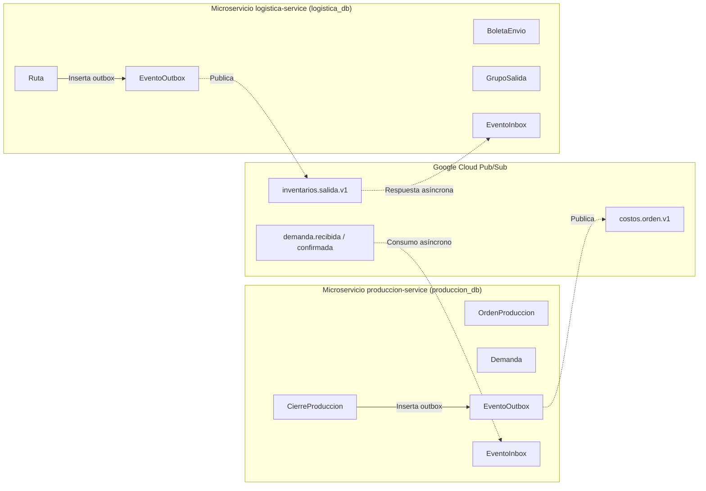

# Evidencia Subtarea ABC-405 (Sprint 3)

**Historia de usuario:** [ABC-404](https://ucb-team-h8yk3x85.atlassian.net/browse/ABC-404) — *[documentacion] [S3-20] Como equipo de desarrollo, quiero documentar los diagramas de clases y secuencias de las funcionalidades del Sprint 3, para mantener actualizada la arquitectura del sistema.*  
**Subtarea:** [ABC-405](https://ucb-team-h8yk3x85.atlassian.net/browse/ABC-405) — *S3-20.01 | Diagramas de clases de produccion-service y logistica-service (6 h)*  
**Responsable:** Andrés Ignacio Pabón Sotomayor  
**Fecha de ejecución:** 11/11/2026  
**Rama:** `RamaAndric`  
**Entorno de ejecución y renderizado:** Node.js v22+, `@mermaid-js/mermaid-cli@12.2.0`, Puppeteer, TypeORM, PostgreSQL.

---

## 1. Objetivo y Criterios de Aceptación Certificados

El objetivo de esta subtarea es modelar, documentar y generar las representaciones gráficas vectoriales y exportables de las entidades relacionales TypeORM de los microservicios `produccion-service` y `logistica-service`, reflejando con exactitud matemática el incremento del **Sprint 3**:

1. **CA-01 (Fidelidad con el Código de `develop`):** Modelar las 40 entidades TypeORM reales implementadas en `produccion-service` (23 entidades) y `logistica-service` (17 entidades), reflejando tipos de datos exactos (`bigint`, `numeric`, `timestamptz`, `jsonb`, `uuid`), identificadores primarios (`PK`), foráneos (`FK`) y restricciones de unicidad.
2. **CA-02 (Aislamiento Arquitectónico de Microservicios):** Mantener independencia estricta de esquemas: `produccion-service` opera exclusivamente sobre `produccion_db` y `logistica-service` sobre `logistica_db`. No existen claves foráneas compartidas a nivel de base de datos; las relaciones entre dominios (ej. `solicitudes_salida.orden_id`) se representan como referencias lógicas desacopladas.
3. **CA-03 (Fuentes Editables Mermaid `.mmd`):** Almacenar las fuentes en `docs/diagramas/sprint-3/clases/`:
   - `01-produccion-service.mmd`
   - `02-logistica-service.mmd`
4. **CA-04 (Formatos de Exportación Múltiples):** Generar para cada diagrama sus versiones en formato vectorial **SVG**, imagen **PNG** (a escala 2 para alta definición) y documento **PDF** ajustado a una página única para impresión y archivo técnico.
5. **CA-05 (Evolución de Entidades Sprint 2 vs Sprint 3):** Identificar mediante estereotipos (`<<Sprint 2>>` y `<<Nuevo Sprint 3>>`) la evolución del modelo de dominio, evidenciando los agregados incorporados en el incremento actual.
6. **CA-06 (Trazabilidad con las 20 HU del Sprint 3):** Actualizar la matriz general en [`docs/diagramas/sprint-3/README.md`](../diagramas/sprint-3/README.md) mapeando cada historia de usuario con las clases correspondientes.

---

## 2. Aislamiento y Límites de Dominio

Ambos microservicios implementan una arquitectura desacoplada orientada a eventos (*Event-Driven Architecture*) y persistencia políglota (*Database-per-Service*):



- **Independencia Transaccional:** Cada microservicio gestiona sus transacciones mediante su propio `DataSource` de TypeORM.
- **Transactional Outbox / Inbox:** La comunicación inter-servicio no bloquea hilos HTTP ni recurre a enlaces de base de datos compartida; todo intercambio se realiza mediante eventos inmutables serializados en JSONB garantizando semántica *at-least-once*.

---

## 3. Inventario y Clasificación de Entidades

### 3.1. `produccion-service` (23 entidades en `produccion_db`)

| Agregado / Módulo | Entidad | Sprint | Propósito en el Dominio |
| --- | --- | --- | --- |
| **Órdenes y Avances** | `OrdenProduccion` | Sprint 2 | Raíz del ciclo de vida productivo. |
| | `HistorialEstadoOrden` | **Nuevo Sprint 3** (ABC-108) | Auditoría cronológica de cambios de estado (`PENDIENTE`, `EN_PROCESO`, `PAUSADA`, `FINALIZADA`). |
| | `AvancesProduccion` | Sprint 2 (ABC-105) | Registro incremental de cantidades terminadas por turno. |
| **Mermas e Incidencias** | `PerdidaMateriaPrima` | **Nuevo Sprint 3** (ABC-74) | Registro justificado de insumos mermados o dañados en planta. |
| | `ObservacionOrden` | **Nuevo Sprint 3** (ABC-100) | Registro de alertas, notas operativas e incidencias menores de la orden. |
| **Calidad y Reprocesos** | `ResultadoConforme` | Sprint 2 | Dictamen de control de calidad (`CONFORME` o `DEFECTUOSO`). |
| | `Reproceso` | **Nuevo Sprint 3** (ABC-394) | Gestión y reincorporación de saldo defectuoso a la orden. |
| | `CierreProduccion` | Sprint 2 ampliado S3 (ABC-114) | Snapshot consolidado de cierre físico y financiero (`estado_contable`). |
| **Recetas y Materiales** | `Receta` | Sprint 2 | Definición de fórmulas de producción. |
| | `RecetaMaterial` | Sprint 2 | Ítems y proporciones requeridas por fórmula. |
| | `Material` | Sprint 2 | Catálogo maestro de materias primas e insumos. |
| | `ConsumoMaterial` | Sprint 2 | Registro de materias primas reales gastadas por orden. |
| | `Lote` | Sprint 2 | Trazabilidad de lote de producción y fecha de vencimiento. |
| | `Inventario` | Sprint 2 | Control de stock físico interno en planta. |
| | `SolicitudMaterial` | Sprint 2 | Pedido formal de insumos hacia almacén. |
| | `SolicitudMaterialItem` | Sprint 2 | Detalle de ítems de materias primas solicitadas. |
| **Demanda Pub/Sub** | `Demanda` | **Nuevo Sprint 3** (ABC-122, ABC-130) | Órdenes de demanda recibidas y confirmadas desde sistemas externos. |
| | `DemandaItem` | **Nuevo Sprint 3** (ABC-122) | Detalle de productos y cantidades requeridas por la demanda. |
| | `DemandaRechazada` | **Nuevo Sprint 3** (ABC-122) | Trazabilidad y auditoría de mensajes rechazados por reglas de negocio. |
| **Disponibilidad Almacén**| `ConsultaDisponibilidad` | **Nuevo Sprint 3** (ABC-70) | Consulta asíncrona de existencias hacia Inventarios previa al inicio. |
| | `ConsultaDisponibilidadItem`| **Nuevo Sprint 3** (ABC-70) | Detalle de disponibilidad por material reportado por Almacén. |
| **Mensajería Durable** | `EventoOutbox` | **Nuevo Sprint 3** (ABC-114) | Eventos salientes pendientes de publicación a Pub/Sub. |
| | `EventoInbox` | **Nuevo Sprint 3** (ABC-122, ABC-130) | Deduplicación transaccional e idempotencia de eventos entrantes. |

### 3.2. `logistica-service` (17 entidades en `logistica_db`)

| Agregado / Módulo | Entidad | Sprint | Propósito en el Dominio |
| --- | --- | --- | --- |
| **Rutas y Despacho** | `Ruta` | **Nuevo Sprint 3** (ABC-128, ABC-368, ABC-374, ABC-384) | Planificación y ejecución de viaje con vehículo, chofer y estado en inventarios (`inventario_estado`). |
| | `RutaParada` | **Nuevo Sprint 3** (ABC-368, ABC-374) | Secuencia física de paradas y destinos de entrega. |
| | `RutaParadaBoleta` | **Nuevo Sprint 3** (ABC-368, ABC-374) | Asociación N:M entre paradas de ruta y boletas transportadas. |
| **Boletas y Solicitudes** | `BoletaEnvio` | Sprint 2 ampliado S3 (ABC-374) | Documento formal de despacho (`BORRADOR`, `EMITIDA`, `EN_RUTA`, `ENTREGADA`, `ANULADA`). |
| | `BoletaEnvioItem` | Sprint 2 | Detalle de ítems y bultos asociados a la boleta. |
| | `BoletaEnvioHistorial` | **Nuevo Sprint 3** (ABC-374, ABC-390) | Historial inmutable de estados de la boleta de envío. |
| | `SolicitudSalida` | Sprint 2 | Requerimiento de salida de producto terminado (referencia lógica a `orden_id`). |
| | `SolicitudSalidaItem` | Sprint 2 | Ítems solicitados para salida. |
| **Agrupación de Carga** | `GrupoSalida` | **Nuevo Sprint 3** (ABC-128) | Lote de consolidación de solicitudes por fecha, destino y tipo de carga. |
| | `GrupoSolicitud` | **Nuevo Sprint 3** (ABC-128) | Tabla de asociación entre solicitudes y su grupo consolidado. |
| **Recursos Externos ERP** | `RecursoExternoSnapshot` | **Nuevo Sprint 3** (ABC-115) | Instantánea diaria de recursos sincronizados desde el ERP. |
| | `RecursoExternoVehiculo` | **Nuevo Sprint 3** (ABC-115, ABC-368) | Vehículos disponibles en el ERP con placa y capacidad de carga. |
| | `RecursoExternoChofer` | **Nuevo Sprint 3** (ABC-115, ABC-368) | Choferes habilitados en el ERP y categoría de licencia. |
| **Incidencias y Cambios** | `IncidenciaTransporte` | **Nuevo Sprint 3** (ABC-379) | Registro formal de desperfectos mecánicos, bloqueos o accidentes. |
| | `ReprogramacionRuta` | **Nuevo Sprint 3** (ABC-379) | Reprogramación justificada de fecha de entrega manteniendo historial. |
| **Mensajería Durable** | `EventoOutbox` | **Nuevo Sprint 3** (ABC-384) | Outbox transaccional para notificaciones `inventarios.salida.v1`. |
| | `EventoInbox` | **Nuevo Sprint 3** (ABC-384) | Inbox transaccional para confirmación/rechazo de inventarios. |

---

## 4. Archivos Generados y Enlaces de Acceso

Los diagramas han sido generados en `docs/diagramas/sprint-3/clases/` en tres formatos:

| Microservicio | Fuente Editable | Diagrama Vectorial (SVG) | Imagen de Alta Resolución (PNG) | Documento Imprimible (PDF) |
| --- | --- | --- | --- | --- |
| **`produccion-service`** | [`01-produccion-service.mmd`](../diagramas/sprint-3/clases/01-produccion-service.mmd) | [`01-produccion-service.svg`](../diagramas/sprint-3/clases/01-produccion-service.svg) | [`01-produccion-service.png`](../diagramas/sprint-3/clases/01-produccion-service.png) | [`01-produccion-service.pdf`](../diagramas/sprint-3/clases/01-produccion-service.pdf) |
| **`logistica-service`** | [`02-logistica-service.mmd`](../diagramas/sprint-3/clases/02-logistica-service.mmd) | [`02-logistica-service.svg`](../diagramas/sprint-3/clases/02-logistica-service.svg) | [`02-logistica-service.png`](../diagramas/sprint-3/clases/02-logistica-service.png) | [`02-logistica-service.pdf`](../diagramas/sprint-3/clases/02-logistica-service.pdf) |

### Verificación de Artefactos Físicos

```powershell
Get-ChildItem -Path "docs\diagramas\sprint-3\clases" | Select-Object Name, Length, LastWriteTime
```

- `01-produccion-service.mmd` (10,150 bytes)
- `01-produccion-service.svg` (371,901 bytes)
- `01-produccion-service.png` (173,391 bytes, escala 2x)
- `01-produccion-service.pdf` (239,535 bytes, página ajustada)
- `02-logistica-service.mmd` (7,460 bytes)
- `02-logistica-service.svg` (321,551 bytes)
- `02-logistica-service.png` (213,855 bytes, escala 2x)
- `02-logistica-service.pdf` (211,120 bytes, página ajustada)

---

## 5. Tabla de Cumplimiento de Funcionalidades (ABC-405)

| Criterio / Requisito | Estado | Evidencia y Verificación |
| --- | :---: | --- |
| **CR-01: Modelado de `produccion-service`** | **CUMPLIDO** | Las 23 entidades de `produccion_db` modeladas exhaustivamente en `01-produccion-service.mmd` con tipos de columna, PKs, FKs y cardinalidades. |
| **CR-02: Modelado de `logistica-service`** | **CUMPLIDO** | Las 17 entidades de `logistica_db` modeladas exhaustivamente en `02-logistica-service.mmd` con tipos de columna, PKs, FKs y cardinalidades. |
| **CR-03: Separación estricta de esquemas de BD** | **CUMPLIDO** | Microservicios completamente desacoplados. No hay relaciones FK entre BDs; relaciones inter-servicio marcadas como lógicas. |
| **CR-04: Exportaciones SVG, PNG y PDF** | **CUMPLIDO** | 8 archivos generados mediante `@mermaid-js/mermaid-cli@12.2.0` con fondo blanco y escala 2x. |
| **CR-05: Distinción Sprint 2 vs Sprint 3 (CA-05)** | **CUMPLIDO** | Estereotipos `<<Sprint 2>>` y `<<Nuevo Sprint 3>>` incorporados en cada clase y documentados en sección analítica de evolución. |
| **CR-06: Matriz general actualizada** | **CUMPLIDO** | `docs/diagramas/sprint-3/README.md` actualizado en su tabla principal y en las 20 historias de usuario vinculadas. |
| **CR-07: Trazabilidad con Git y Jira** | **CUMPLIDO** | Subtarea [ABC-405](https://ucb-team-h8yk3x85.atlassian.net/browse/ABC-405) en curso, commit local listo para Push y PR a `develop`. |
