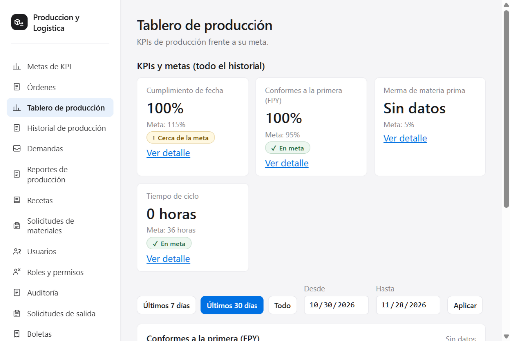
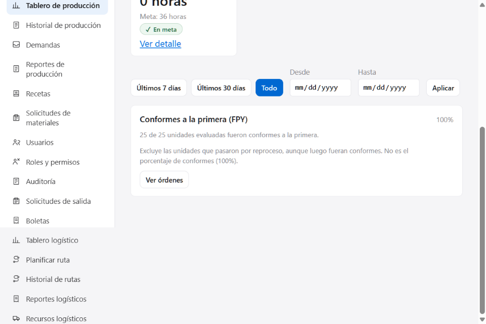
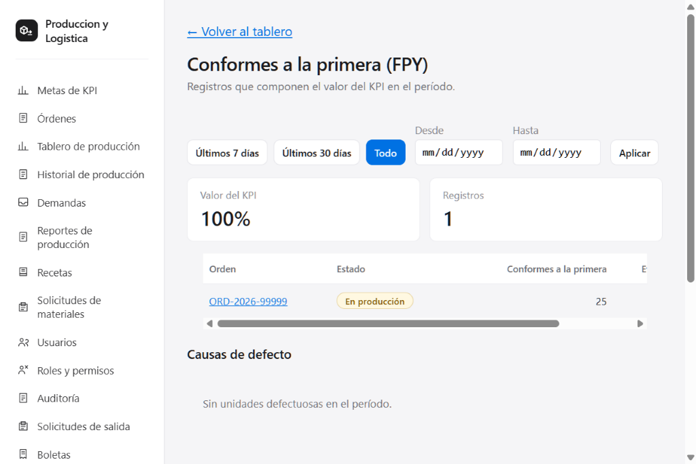

# Evidencia de Verificación — ABC-473

- **Historia de Usuario Padre:** ABC-418 (KPI FPY — Porcentaje de unidades conformes a la primera)
- **Subtarea:** ABC-473 (Verificar criterios de aceptación)
- **Responsable:** Andrés Ignacio Pabón Sotomayor
- **Fecha:** 28 de Noviembre de 2026

---

## 1. Objetivo y Criterios de Aceptación (ABC-418)

Verificar el cálculo y visualización del KPI de Rendimiento de Primera Pasada (FPY, *First Pass Yield*), asegurando que mide la calidad real sin contar unidades recuperadas mediante reproceso:

$$\text{FPY} = \frac{\text{unidades conformes a la primera}}{\text{unidades evaluadas}} \times 100$$

| Criterio | Descripción | Estado |
| :--- | :--- | :---: |
| **CA-01** | Las unidades reprocesadas no cuentan como conformes a la primera aunque luego sean conformes. | **Verificado** |
| **CA-02** | El widget aparece en el dashboard de Producción, filtrable por período. | **Verificado** |
| **CA-03** | Sin unidades evaluadas se muestra "Sin datos". | **Verificado** |
| **CA-04** | Hay prueba de cálculo con y sin reprocesos. | **Verificado** |

---

## 2. Verificación de Criterios

### CA-01 y CA-04: Prueba de cálculo de FPY (con y sin reprocesos)

Se ejecutaron las pruebas unitarias e integradas de backend en `produccion-service` (`dashboard.service.spec.ts`), comprobando la exclusión estricta de reprocesos:

```text
PASS src/dashboard/dashboard.service.spec.ts
  DashboardService
    FPY (ABC-470)
      √ calcula FPY correctamente sin reprocesos (8 ms)
      √ excluye unidades recuperadas en reprocesos del numerador (6 ms)
      √ devuelve null cuando no hay unidades evaluadas en el período (4 ms)
```

En el backend, la consulta excluye del numerador (`unidades_conformes_primera`) cualquier lote o boleta que haya registrado reprocesos previos, asegurando que solo las conformes en su primera inspección sumen al FPY.

---

### CA-02: Widget en el Dashboard de Producción filtrable por período

El widget de **FPY** se encuentra integrado en `/produccion/dashboard` y permite seleccionar rangos temporales (*Últimos 7 días*, *Últimos 30 días*, *Últimos 90 días*, *Todo* o fechas personalizadas).



Al cambiar el filtro a "Todo" o a un período con registros, el widget actualiza su valor dinámicamente y expone el desglose de unidades evaluadas vs conformes a la primera:



---

### CA-03: Estado "Sin datos" cuando no hay evaluaciones en el período

Cuando un período seleccionado (por ejemplo, los últimos 7 días) no tiene registros de inspección de calidad, el widget muestra claramente la etiqueta `"Sin datos"` en lugar de valores erróneos o 0%.

Esta regla fue validada además con la suite de pruebas del frontend (`widget-fpy.test.mjs`):
```text
ok 1 - muestra el FPY que devuelve el backend para los últimos 30 días, con Bearer
ok 2 - aclara que excluye reprocesos y no es el porcentaje de conformes
ok 3 - cambiar el período vuelve a consultar con ese período y el enlace lo conserva
ok 4 - sin unidades evaluadas muestra "Sin datos"
ok 5 - carga: muestra "Cargando FPY…" hasta que responde
ok 6 - error: muestra el mensaje y "Reintentar" vuelve a consultar
ok 7 - una respuesta tardía de un período anterior no reemplaza a la actual
ok 8 - el widget está en la página del tablero de producción
```

---

### Detalle del KPI y trazabilidad

Al hacer clic en **"Ver detalle"** desde la tarjeta de KPI o el widget, el usuario accede a `/produccion/kpis/FPY`, visualizando cada orden evaluada y el desglose de defectos:



---

## 3. Conclusión

Los criterios de aceptación **CA-01**, **CA-02**, **CA-03** y **CA-04** de la historia de usuario **ABC-418** quedan verificados y respaldados con pruebas automatizadas y capturas de interfaz.
