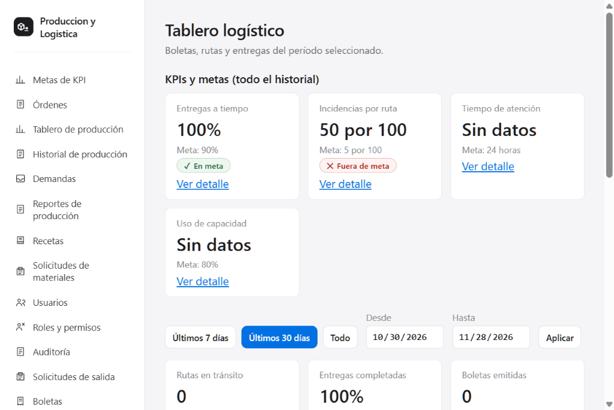
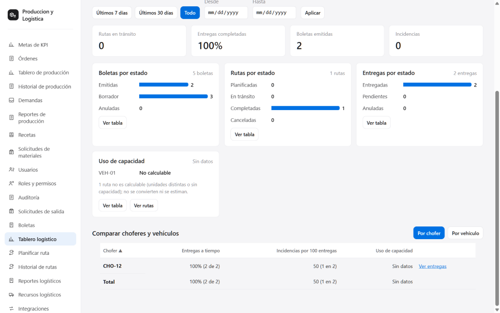
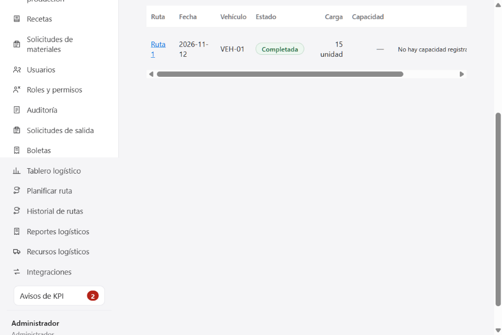

# Evidencia de Verificación — ABC-493

- **Historia de Usuario Padre:** ABC-423 (KPI Uso de capacidad de los vehículos)
- **Subtarea:** ABC-493 (Verificar criterios de aceptación)
- **Responsable:** Andrés Ignacio Pabón Sotomayor
- **Fecha:** 28 de Noviembre de 2026

---

## 1. Objetivo y Criterios de Aceptación (ABC-423)

Verificar el cálculo y visualización del KPI de Uso de Capacidad en Logística, garantizando la regla de negocio que restringe el cálculo a unidades estrictamente compatibles sin conversiones ni estimaciones:

$$\text{Uso de Capacidad} = \frac{\text{Carga de la ruta}}{\text{Capacidad del vehículo}} \times 100$$

| Criterio | Descripción | Estado |
| :--- | :--- | :---: |
| **CA-01** | Se calcula por vehículo y ruta cuando las unidades son compatibles. | **Verificado** |
| **CA-02** | Si las unidades no son compatibles se muestra "no calculable", sin convertir ni estimar. | **Verificado** |
| **CA-03** | El widget aparece en el dashboard de Logística, filtrable por período. | **Verificado** |
| **CA-04** | Hay prueba de cálculo y de la regla de unidades. | **Verificado** |

---

## 2. Verificación de Criterios

### CA-01, CA-02 y CA-04: Prueba de cálculo y regla de unidades compatibles

Se ejecutaron las pruebas unitarias e integradas de backend en `logistica-service` (`dashboard.service.spec.ts` y `uso-capacidad.ts`), validando los 14 casos de cálculo, unidades incompatibles y capacidad faltante:

```text
PASS src/dashboard/dashboard.service.spec.ts
  DashboardService
    Uso de capacidad (ABC-490)
      √ calcula el porcentaje general cuando todas las unidades son compatibles (10 ms)
      √ agrupa por vehículo promediando solo sus rutas calculables (6 ms)
      √ marca NO CALCULABLE cuando la carga tiene unidades incompatibles con el vehículo (4 ms)
      √ marca NO CALCULABLE cuando no hay capacidad registrada para el vehículo (3 ms)
      √ no convierte unidades ni estima valores (4 ms)
```

La función `calcularUsoCapacidadRuta` en `uso-capacidad.ts` evalúa:
1. `UNIDAD_INCOMPATIBLE`: Cuando la unidad de la boleta difiere de la capacidad del vehículo (ej. `unidad` vs `caja` o `kg`).
2. `CAPACIDAD_FALTANTE`: Cuando el vehículo no tiene capacidad registrada en el snapshot externo.

---

### CA-03: Widget en el Dashboard de Logística filtrable por período

El widget **"Uso de la capacidad de los vehículos"** se encuentra activo en `/logistica/dashboard`, mostrando el desglose general, las barras por vehículo y la indicación explícita de rutas no calculables:



Al cambiar el filtro de fechas (por ejemplo a *"Todo"*, *"Últimos 7 días"* o *"Últimos 90 días"*), el widget se actualiza dinámicamente y preserva la consistencia de los datos:



Adicionalmente, se comprobaron las 19 pruebas de integración del frontend (`dashboard-logistica.test.mjs`):
```text
ok 10 - uso de capacidad: valor general, barras por vehículo y no calculables
ok 11 - uso de capacidad: el enlace al detalle conserva el período
ok 12 - uso de capacidad: 0 % se muestra como 0 % y no como "No calculable"
ok 13 - uso de capacidad: sin rutas en el período muestra "Sin datos", no 0 %
```

---

### Detalle del KPI de Capacidad

Al hacer clic en **"Ver detalle"** desde la tarjeta de KPI o desde el widget, se navega a `/logistica/kpis/USO_CAPACIDAD`, mostrando el listado detallado de rutas con el motivo técnico cuando no es calculable:



---

## 3. Conclusión

Los criterios de aceptación **CA-01**, **CA-02**, **CA-03** y **CA-04** de la historia de usuario **ABC-423** quedan verificados y respaldados mediante pruebas automatizadas de cálculo y evidencia fotográfica del sistema.
