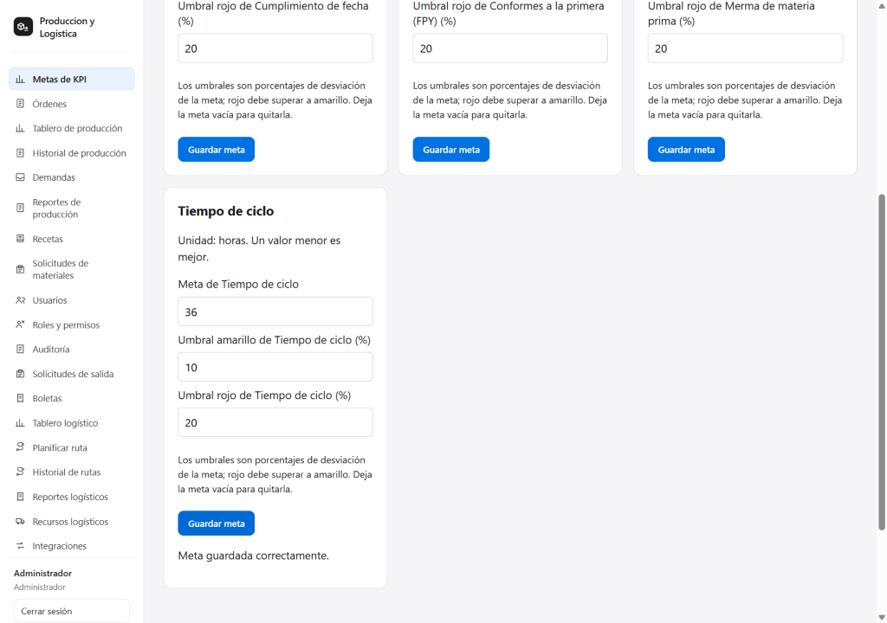
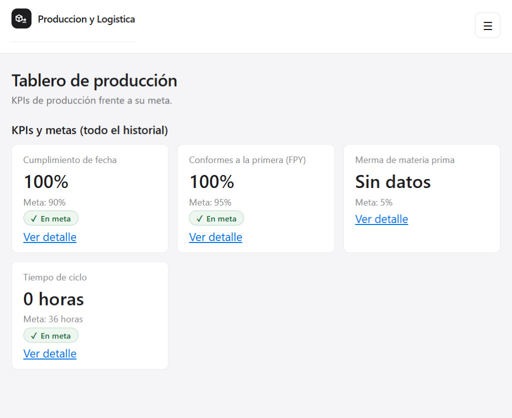
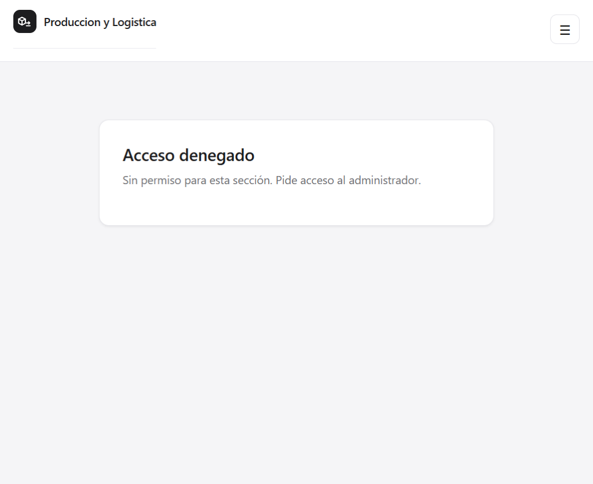

# ABC-499 — Verificación de criterios de aceptación: Metas de KPI y semáforo (ABC-424)

**Historia de usuario:** ABC-424 — *Como supervisor, quiero definir la meta de cada KPI y ver su semáforo, para saber de un vistazo qué está fuera de lo esperado.*  
**Fecha de verificación:** 25 de noviembre de 2026.  
**Rama:** `RamaAndric`.  
**Subtareas que integran la HU:**
- **ABC-494:** Entidad `metas_kpi` y migración en base de datos PostgreSQL.
- **ABC-495:** Endpoints de configuración (`GET/PUT /dashboard/kpis/metas/:kpi`) y cálculo del semáforo.
- **ABC-496:** Pantalla de configuración de metas (`/kpis/metas`).
- **ABC-497:** Semáforo de KPIs en los tableros de Producción y Logística (`TarjetasKpi.jsx` y badges).
- **ABC-499:** Verificación integral de criterios de aceptación (CA-01 a CA-04) y evidencia.

---

## 1. Criterio CA-01: Guardar y editar la meta de cada KPI, con umbrales de amarillo y rojo

* **Comportamiento esperado:** El supervisor puede consultar y editar las metas y umbrales (amarillo % y rojo %) de los KPIs. Los cambios se persisten en base de datos.
* **Verificación en navegador real:**
  - Se accedió a `http://localhost:5173/kpis/metas` con usuario supervisor (`admin@taller.local`).
  - Se cargaron los formularios de configuración de metas para los KPIs de Producción (`CUMPLIMIENTO_FECHA`, `FPY`, `MERMA`, `TIEMPO_CICLO`).
  - Se editó la meta de **Tiempo de ciclo** de `48` a `36` horas (con umbral amarillo `10%` y rojo `20%`) y se presionó **Guardar meta**.
  - La API respondió `HTTP 204` y la pantalla mostró la confirmación: **"Meta guardada correctamente."**



---

## 2. Criterio CA-02: Regla del semáforo considerando sentido del KPI

* **Comportamiento esperado:** La regla del semáforo distingue si el KPI mejora hacia arriba (`MAYOR_ES_MEJOR`, ej. FPY o Cumplimiento de fecha) o hacia abajo (`MENOR_ES_MEJOR`, ej. Tiempo de ciclo o Merma).
* **Verificación técnica:**
  - **Pruebas unitarias de semáforo (`semaforo.spec.ts`):** 100% de pruebas aprobadas en `produccion-service` y `logistica-service`.
    - `MAYOR_ES_MEJOR`:
      - Valor $\ge$ Meta $\rightarrow$ **VERDE** (`✓ En meta`).
      - Valor dentro del umbral amarillo $\rightarrow$ **AMARILLO** (`⚠️ Desviación leve`).
      - Valor por debajo del umbral rojo $\rightarrow$ **ROJO** (`✕ Desviación crítica`).
    - `MENOR_ES_MEJOR`:
      - Valor $\le$ Meta $\rightarrow$ **VERDE** (`✓ En meta`).
      - Valor que excede la meta dentro del umbral amarillo $\rightarrow$ **AMARILLO**.
      - Valor que excede la meta por encima del umbral rojo $\rightarrow$ **ROJO**.
  - **En vivo en el tablero:**
    - `Cumplimiento de fecha` (`MAYOR_ES_MEJOR`): valor `100%`, meta `90%` $\rightarrow$ Semáforo verde `✓ En meta`.
    - `Tiempo de ciclo` (`MENOR_ES_MEJOR`): valor `0 horas`, meta `36 horas` $\rightarrow$ Semáforo verde `✓ En meta`.

---

## 3. Criterio CA-03: Visualización en widgets y KPI sin meta

* **Comportamiento esperado:** Las tarjetas del tablero muestran el valor actual, la meta y la insignia del semáforo. Un KPI sin meta se muestra con texto "Sin meta" y sin color de semáforo; un KPI sin datos muestra "Sin datos".
* **Verificación en navegador real:**
  - En `http://localhost:5173/produccion/dashboard`:
    - **Cumplimiento de fecha:** `100%` | `Meta: 90%` | Insignia verde `✓ En meta`.
    - **Conformes a la primera (FPY):** `100%` | `Meta: 95%` | Insignia verde `✓ En meta`.
    - **Merma de materia prima:** `Sin datos` | `Meta: 5%` | Sin insignia de semáforo.
    - **Tiempo de ciclo:** `0 horas` | **`Meta: 36 horas`** (actualizada en CA-01) | Insignia verde `✓ En meta`.



---

## 4. Criterio CA-04: Control de acceso (solo rol supervisor)

* **Comportamiento esperado:** Solo los roles con el permiso `kpis.metas.gestionar` pueden acceder a `/kpis/metas` y ejecutar `PUT /dashboard/kpis/metas/:kpi`. Los demás usuarios reciben rechazo (`403 Forbidden` en la API y "Acceso denegado" en la interfaz).
* **Verificación técnica y visual:**
  - **En el backend (`PermisoProduccionGuard`):** El endpoint `@Put('kpis/metas/:kpi')` exige `@SetMetadata(PERMISO_PRODUCCION, 'kpis.metas.gestionar')`. Usuarios sin este permiso reciben `403 Forbidden`.
  - **En el frontend:** La ruta `/kpis/metas` está protegida por `privada(<MetasKpiPage />, [PERMISO_GESTIONAR_METAS])`.
  - **Evidencia visual previa a asignación del permiso:** Al intentar acceder sin el permiso `kpis.metas.gestionar`, la aplicación muestra la alerta de seguridad:  
    *"Acceso denegado: Sin permiso para esta sección. Pide acceso al administrador."*



---

## 5. Salida de pruebas automatizadas

### A) Frontend (`npm run test:metas-kpi`)
```text
> frontend@0.1.0 test:metas-kpi
> node --test scripts/metas-kpi.test.mjs

TAP version 13
ok 1 - carga las ocho metas sin inventar cero y muestra la navegación autorizada
ok 2 - guarda números en el área correcta y recupera la configuración al volver a abrir
ok 3 - vaciar una meta envía null y deja el KPI sin semáforo
ok 4 - umbrales incoherentes se rechazan antes del HTTP
ok 5 - sin permiso de gestión no carga datos ni muestra el enlace
ok 6 - respeta el permiso de consulta de cada área
ok 7 - un fallo de carga permite reintentar
ok 8 - un rechazo 403 al guardar no confirma éxito
ok 9 - sesión expirada al consultar muestra el mensaje correspondiente
ok 10 - valida precisión, límites, no finitos y blancos de los campos obligatorios
1..10
# tests 10
# pass 10
# fail 0
```

### B) Backend (`npx jest src/dashboard/semaforo.spec.ts`)
```text
PASS src/dashboard/semaforo.spec.ts
  calcularSemaforo
    sentido MAYOR_ES_MEJOR (ej. FPY, cumplimiento de fecha)
      ✓ en meta o por encima: verde (1 ms)
      ✓ dentro del umbral amarillo: amarillo
      ✓ por debajo del umbral rojo: rojo
    sentido MENOR_ES_MEJOR (ej. tiempo de ciclo, merma)
      ✓ en meta o por debajo: verde
      ✓ dentro del umbral amarillo: amarillo
      ✓ por encima del umbral rojo: rojo
    casos sin semaforo
      ✓ valor nulo devuelve color nulo
      ✓ meta nula devuelve color nulo

Test Suites: 1 passed, 1 total
Tests:       8 passed, 8 total
```

---

## Conclusión

Se verificaron con éxito los criterios **CA-01**, **CA-02**, **CA-03** y **CA-04** tanto en pruebas automatizadas como en entorno real conectado a PostgreSQL y explorado mediante navegador. La historia de usuario **ABC-424** cumple con su definición de terminado.
